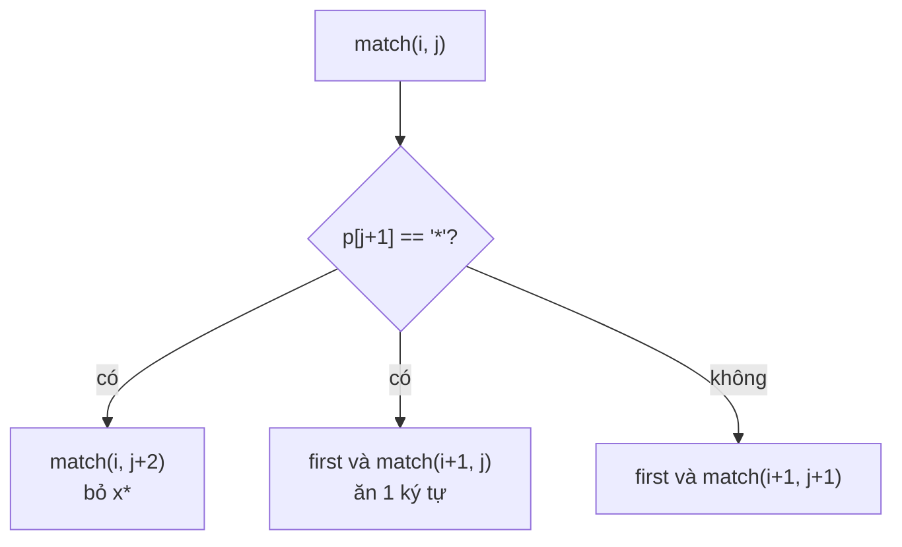

<!-- approaches: Recursion · Memoized recursion · Bottom-up DP -->
# 10. Regular Expression Matching

**Hard** · String · Dynamic Programming · Recursion · [LeetCode ↗](https://leetcode.com/problems/regular-expression-matching/) · Code: [RegularExpressionMatching.java](RegularExpressionMatching.java) · Tests: [RegularExpressionMatchingTest.java](RegularExpressionMatchingTest.java)

## Đề bài

Cài đặt so khớp biểu thức chính quy với `.` (một ký tự bất kỳ) và `*` (lặp **0 hoặc nhiều lần** ký tự ngay trước). Phải khớp **toàn bộ** chuỗi.

```
("aa", "a")     -> false       ("aa", "a*")    -> true
("ab", ".*")    -> true        ("aab", "c*a*b") -> true   (c* = rỗng, a* = "aa")
```

## Ý tưởng

> Đọc pattern từng **đơn vị**: một ký tự thường/`.`, hoặc một cặp `x*`. Với `x*` có đúng hai lựa chọn:
> 1. **bỏ qua** cặp `x*` (khớp 0 lần);
> 2. nếu ký tự hiện tại khớp `x`, **ăn** một ký tự của chuỗi và giữ nguyên `x*` (khớp thêm một lần).



`first` = còn ký tự và `p[j] == s[i] || p[j] == '.'`.

## Cách 1 — Đệ quy thuần

Viết thẳng hai lựa chọn trên. Đúng, nhưng có thể lũy thừa (`"aaaaaaaaab"` vs `"a*a*a*a*c"`).

## Cách 2 — Đệ quy có nhớ `O(m·n)`

Trạng thái chỉ là cặp chỉ số `(i, j)` → tối đa `(m+1)(n+1)` trạng thái, mỗi trạng thái tính một lần.

## Cách 3 — DP từ dưới lên `O(m·n)` ⭐

`dp[i][j]` = `s[0..i)` có khớp `p[0..j)` không.

| p[j−1] | công thức |
|---|---|
| chữ hoặc `.` | `dp[i−1][j−1]` và `s[i−1]` khớp `p[j−1]` |
| `*` | `dp[i][j−2]` (0 lần) **hoặc** (`dp[i−1][j]` và `s[i−1]` khớp `p[j−2]`) |

Bảng cho `s = "aab"`, `p = "c*a*b"` (T = true):

| | "" | c | c* | a | a* | b |
|---|---|---|---|---|---|---|
| "" | T | | T | | T | |
| a | | | | T | T | |
| aa | | | | | T | |
| aab | | | | | | **T** |

Hàng đầu: `c*`, `c*a*` khớp chuỗi rỗng — phải khởi tạo riêng.

## Bẫy & lưu ý

- `*` đi **cùng** ký tự trước nó; không bao giờ xét `*` một mình.
- Khởi tạo `dp[0][j]` cho pattern dạng `a*b*c*`.
- Test so với `String.matches` của Java trên 5000 ca ngẫu nhiên.

## Bài liên quan

44 Wildcard Matching · 72 Edit Distance · 1143 Longest Common Subsequence.
