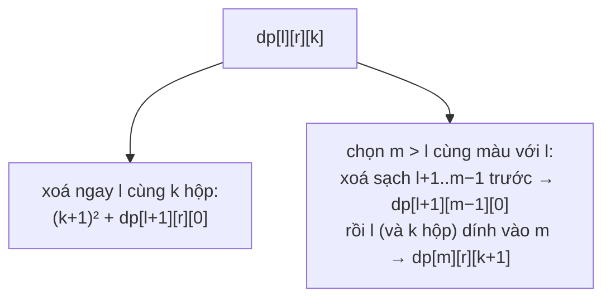

<!-- approaches: Interval DP with a count of equal boxes attached on the left -->
# 546. Remove Boxes

**Hard** · Array · Dynamic Programming · Memoization · [LeetCode ↗](https://leetcode.com/problems/remove-boxes/) · Code: [RemoveBoxes.java](RemoveBoxes.java) · Tests: [RemoveBoxesTest.java](RemoveBoxesTest.java)

## Đề bài

Dãy hộp có màu. Xoá `k` hộp **liền nhau cùng màu** được `k²` điểm. Xoá hết hộp, điểm tối đa?

```
[1,3,2,2,2,3,4,3,1] -> 23
  xoá 2,2,2 (9) → [1,3,3,4,3,1] → xoá 4 (1) → [1,3,3,3,1] → xoá 3,3,3 (9) → [1,1] → xoá (4)   = 23
```

## Ý tưởng

> Khó vì `k²` thưởng cho việc **gom** hộp cùng màu lại: đôi khi nên xoá phần ở giữa trước để hai nhóm cùng màu dính vào nhau. DP khoảng `dp[l][r]` **không đủ** thông tin — cần biết thêm có bao nhiêu hộp cùng màu với `boxes[l]` **đang chờ dính** vào nó từ bên trái.
> `dp[l][r][k]` = điểm tốt nhất cho đoạn `l..r` khi có `k` hộp cùng màu `boxes[l]` đã dính vào bên trái `l`.

Hai lựa chọn cho hộp `l`:



## Lời giải — DP khoảng ba chiều `O(n⁴)` ⭐

Tối ưu nhỏ: nếu các hộp đầu đoạn cùng màu liên tiếp, gộp chúng vào `k` ngay để giảm số trạng thái.

Đây là ví dụ kinh điển của việc **thêm một chiều trạng thái** khi DP khoảng thông thường thiếu thông tin — "điều gì nằm ngoài khoảng nhưng ảnh hưởng tới nó".

## Bài liên quan

312 Burst Balloons · 664 Strange Printer · 1000 Minimum Cost to Merge Stones · 1547 Minimum Cost to Cut a Stick.
