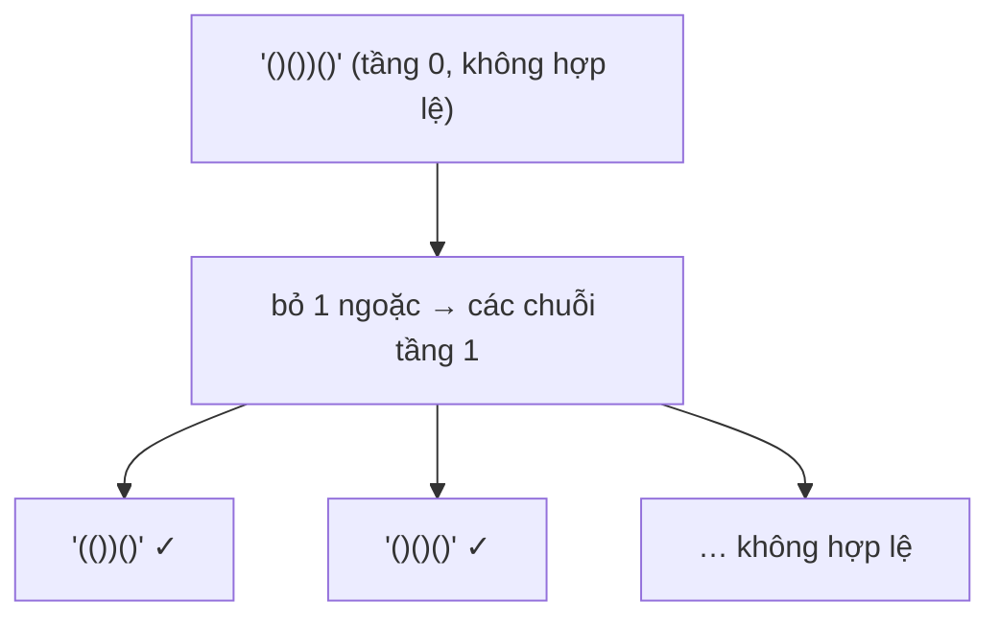

<!-- approaches: BFS by number of removals · Backtracking with exact removal counts -->
# 301. Remove Invalid Parentheses

**Hard** · String · Backtracking · Breadth-First Search · [LeetCode ↗](https://leetcode.com/problems/remove-invalid-parentheses/) · Code: [RemoveInvalidParentheses.java](RemoveInvalidParentheses.java) · Tests: [RemoveInvalidParenthesesTest.java](RemoveInvalidParenthesesTest.java)

## Đề bài

Xoá **ít ngoặc nhất** để chuỗi hợp lệ (chữ cái giữ nguyên). Trả về **mọi** kết quả khác nhau.

```
"()())()" -> ["(())()", "()()()"]
")("      -> [""]
```

## Ý tưởng

> "Ít nhất" gợi ý **BFS**: tầng 0 là chuỗi gốc, tầng 1 là mọi chuỗi bỏ đi một ngoặc, tầng 2 bỏ hai ngoặc… Tầng **đầu tiên** có chuỗi hợp lệ cho đáp án — gom mọi chuỗi hợp lệ ở tầng đó rồi dừng.



## Cách 1 — BFS theo số ngoặc bị xoá

`HashSet` tránh xét lại cùng một chuỗi. Đơn giản, đúng, nhưng sinh rất nhiều chuỗi trung gian.

## Cách 2 — Đếm trước số ngoặc thừa + backtracking ⭐

1. Quét một lượt: đếm số `(` **chưa đóng** và số `)` **không có cặp** — đó chính xác là số ngoặc mỗi loại **phải** xoá.
2. Backtrack chỉ xoá đúng chừng ấy.
3. Bỏ qua ký tự giống ký tự **ngay trước** ở cùng tầng (xoá ngoặc nào trong một dãy ngoặc giống nhau cũng cho cùng kết quả) — tránh sinh trùng.

`"()())()"`: một `)` thừa, không có `(` thừa → chỉ cần thử xoá một dấu `)`.

## Bài liên quan

20 Valid Parentheses · 32 Longest Valid Parentheses · 1249 Minimum Remove to Make Valid Parentheses (chỉ cần một kết quả) · 22 Generate Parentheses.
