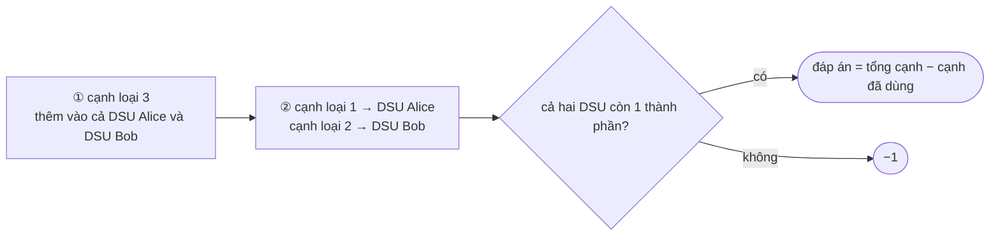

<!-- approaches: Union-find, shared edges first -->
# 1579. Remove Max Number of Edges to Keep Graph Fully Traversable

**Hard** · Union-Find · Graph Theory · [LeetCode ↗](https://leetcode.com/problems/remove-max-number-of-edges-to-keep-graph-fully-traversable/) · Code: [RemoveMaxNumberOfEdgesToKeepGraphFullyTraversable.java](RemoveMaxNumberOfEdgesToKeepGraphFullyTraversable.java) · Tests: [RemoveMaxNumberOfEdgesToKeepGraphFullyTraversableTest.java](RemoveMaxNumberOfEdgesToKeepGraphFullyTraversableTest.java)

## Đề bài

Đồ thị vô hướng với ba loại cạnh: `1` chỉ Alice đi được, `2` chỉ Bob, `3` cả hai. Bỏ **nhiều cạnh nhất** sao cho cả Alice và Bob vẫn đi được tới **mọi** đỉnh. Không thể ngay từ đầu → `−1`.

## Ý tưởng

> Mỗi người cần một **cây khung** riêng (`n − 1` cạnh). Một cạnh loại 3 có thể nằm trong **cả hai** cây khung cùng lúc → đáng giá gấp đôi.
> **Tham lam:** thêm **cạnh loại 3 trước**, rồi mới tới cạnh riêng. Cạnh nào không nối thêm được gì (hai đầu đã liên thông) thì bỏ được. Kiểm tra liên thông bằng **Union-Find**.

Ví dụ 1 (n = 4):

| cạnh | loại | Alice nối mới? | Bob nối mới? | dùng? |
|---|---|---|---|---|
| 1–2 | 3 | ✓ | ✓ | ✓ |
| 2–3 | 3 | ✓ | ✓ | ✓ |
| 1–3 | 1 | ✗ (đã liên thông) | | bỏ |
| 2–4 | 1 | ✓ | | ✓ |
| 1–2 | 1 | ✗ | | bỏ |
| 3–4 | 2 | | ✓ | ✓ |

Dùng 4 cạnh, bỏ **2**.

## Vì sao tham lam đúng?

Giả sử một lời giải tối ưu dùng cạnh riêng `e` thay cho một cạnh loại 3 `f` có thể nối cùng hai thành phần. Đổi `e` lấy `f`: `f` phục vụ được **cả hai** người → số cạnh dùng không tăng. Nên luôn ưu tiên cạnh dùng chung (lập luận trao đổi như thuật toán Kruskal). Test kiểm chứng bằng vét cạn mọi tập con cạnh trên đồ thị nhỏ.

## Bài liên quan

684 Redundant Connection · 1584 Min Cost to Connect All Points (Kruskal) · 1135 Connecting Cities With Minimum Cost · 547 Number of Provinces.
