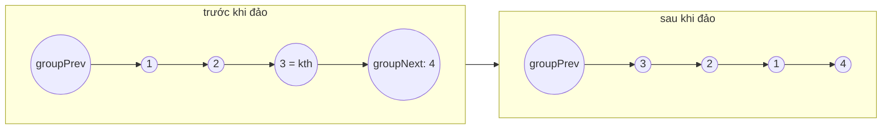

<!-- approaches: Iterative group reversal with dummy · Recursive -->
# 25. Reverse Nodes in k-Group

**Hard** · Linked List · Recursion · [LeetCode ↗](https://leetcode.com/problems/reverse-nodes-in-k-group/) · Code: [ReverseNodesInKGroup.java](ReverseNodesInKGroup.java) · Tests: [ReverseNodesInKGroupTest.java](ReverseNodesInKGroupTest.java)

## Đề bài

Đảo ngược danh sách liên kết theo từng **nhóm `k` node**; nhóm cuối không đủ `k` node thì giữ nguyên. Chỉ đổi liên kết. Follow-up: `O(1)` bộ nhớ.

```
1 → 2 → 3 → 4 → 5, k = 3   =>   3 → 2 → 1 → 4 → 5
```

## Ý tưởng

> Lặp: với mỗi nhóm, (1) kiểm tra còn đủ `k` node, (2) **đảo nhóm** bằng đúng thuật toán bài 206, (3) **nối** nhóm đã đảo vào phần trước và phần sau.
> Cần nhớ bốn node: `groupPrev` (trước nhóm), `kth` (cuối nhóm → thành đầu mới), `oldFirst` (đầu nhóm → thành đuôi mới), `groupNext` (sau nhóm).



Mẹo: khởi tạo `prev = groupNext` khi đảo, nên node đầu nhóm (sẽ thành đuôi) **tự động** trỏ tới phần sau — không cần nối riêng. Sau đó `groupPrev` dời tới `oldFirst` để xử lý nhóm kế tiếp.

## Cách 1 — Lặp với node giả `O(n) · O(1)` ⭐

## Cách 2 — Đệ quy

Đảo `k` node đầu, nối với kết quả đệ quy của phần còn lại. Gọn hơn nhưng stack `O(n/k)`.

## Bẫy & lưu ý

- Phải **đếm đủ `k` node trước** khi đảo — đảo xong mới phát hiện thiếu thì phải đảo lại.

## Bài liên quan

206 Reverse Linked List · 92 Reverse Linked List II · 24 Swap Nodes in Pairs (k = 2) · 2074 Reverse Nodes in Even Length Groups.
