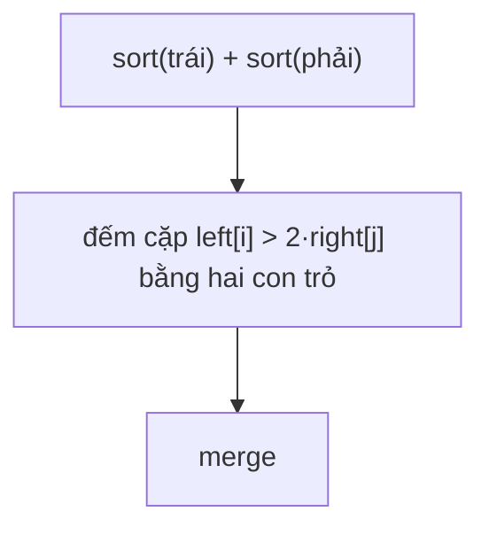

<!-- approaches: Merge sort counting before merging · Fenwick tree over compressed values -->
# 493. Reverse Pairs

**Hard** · Array · Binary Search · Divide and Conquer · Binary Indexed Tree · [LeetCode ↗](https://leetcode.com/problems/reverse-pairs/) · Code: [ReversePairs.java](ReversePairs.java) · Tests: [ReversePairsTest.java](ReversePairsTest.java)

## Đề bài

Đếm số cặp `i < j` mà `nums[i] > 2 · nums[j]`.

```
[2,4,3,5,1] -> 3     (4,1) (3,1) (5,1)
```

## Ý tưởng — merge sort

> Giống đếm **nghịch thế** (inversion). Trong merge sort, sau khi hai nửa đã sắp xếp, mọi cặp "một bên trái, một bên phải" đều có `i < j`. Vì hai nửa đã sắp xếp, **đếm bằng hai con trỏ**: với mỗi `left[i]` (tăng dần), con trỏ `j` trên nửa phải chỉ tiến lên.
> Đếm **trước** khi merge (điều kiện `> 2·` khác điều kiện so sánh khi merge).

```
trái: [2, 4]     phải: [1, 3, 5]   (đã sắp xếp)
2 > 2·1? không  → 0
4 > 2·1? có, 4 > 2·3? không → 1
```



## Cách 1 — Merge sort `O(n log n)` ⭐

**Bẫy tràn số:** `2 · nums[j]` vượt `int` khi giá trị gần `±2³¹` → nhân bằng `long`.

## Cách 2 — Cây Fenwick

Nén giá trị, quét trái sang phải: đếm số phần tử **đã gặp** có giá trị `> 2x` (= đã gặp − số phần tử `≤ 2x`), rồi thêm `x` vào cây.

## Bài liên quan

315 Count of Smaller Numbers After Self · 327 Count of Range Sum · 2426 Number of Pairs Satisfying Inequality · Đếm nghịch thế.
