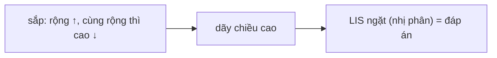

<!-- approaches: Sort + LIS with binary search · Sort + O(n²) DP -->
# 354. Russian Doll Envelopes

**Hard** · Array · Binary Search · Dynamic Programming · Sorting · [LeetCode ↗](https://leetcode.com/problems/russian-doll-envelopes/) · Code: [RussianDollEnvelopes.java](RussianDollEnvelopes.java) · Tests: [RussianDollEnvelopesTest.java](RussianDollEnvelopesTest.java)

## Đề bài

Phong bì `[rộng, cao]`. Phong bì A lồng được vào B nếu **cả** chiều rộng **và** chiều cao của A đều **nhỏ hơn hẳn** B. Lồng được nhiều nhất bao nhiêu lớp?

```
[[5,4],[6,4],[6,7],[2,3]] -> 3    [2,3] ⊂ [5,4] ⊂ [6,7]
```

## Ý tưởng

> Sắp xếp theo **chiều rộng tăng dần** → chỉ còn phải chọn dãy có **chiều cao tăng ngặt** = bài **300 Longest Increasing Subsequence**.
> **Bẫy:** các phong bì **cùng chiều rộng** không lồng được vào nhau, nhưng LIS trên chiều cao có thể chọn cả hai (ví dụ `[6,4]` rồi `[6,7]`). Cách xử lý thông minh: với cùng chiều rộng, sắp chiều cao **giảm dần** — khi đó trong cùng một nhóm chiều rộng, chiều cao giảm nên LIS **không bao giờ** chọn được hai phong bì cùng nhóm.

| sau khi sắp | [2,3] | [5,4] | [6,7] | [6,4] |
|---|---|---|---|---|
| chiều cao | 3 | 4 | 7 | 4 |

LIS của `3, 4, 7, 4` = `3, 4, 7` → **3**. (Nếu sắp chiều cao tăng: `3, 4, 4, 7` → LIS ngặt vẫn 3 ở đây, nhưng với `[[2,3],[2,4],[2,5]]` sẽ sai thành 3 thay vì 1.)



## Cách 1 — Sắp xếp + LIS nhị phân `O(n log n)` ⭐

## Cách 2 — Sắp xếp + DP `O(n²)`

`dp[i]` = chuỗi lồng dài nhất kết thúc ở phong bì `i`; kiểm tra **cả hai** chiều nhỏ hơn hẳn. Dùng làm chuẩn để test.

## Bài liên quan

300 Longest Increasing Subsequence · 1691 Maximum Height by Stacking Cuboids · 646 Maximum Length of Pair Chain · 960 Delete Columns to Make Sorted III.
