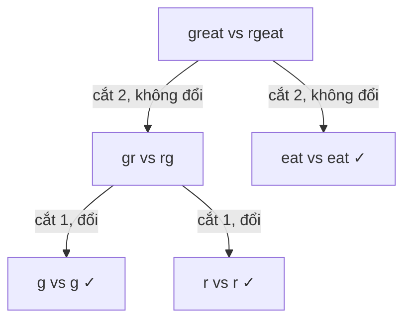

<!-- approaches: Recursion with memo on substrings · 3D DP over (i, j, length) -->
# 87. Scramble String

**Hard** · String · Dynamic Programming · [LeetCode ↗](https://leetcode.com/problems/scramble-string/) · Code: [ScrambleString.java](ScrambleString.java) · Tests: [ScrambleStringTest.java](ScrambleStringTest.java)

## Đề bài

"Xáo" chuỗi `s`: cắt thành hai phần khác rỗng, có thể **đổi chỗ** hai phần, rồi xáo đệ quy từng phần. Cho `s1`, `s2` cùng độ dài, hỏi `s2` có phải một cách xáo của `s1` không.

```
great -> gr|eat -> rg|eat (đổi chỗ "gr") -> "rgeat"   ✓
```

## Ý tưởng

> Thử mọi **vị trí cắt** `i` của `s1`. Có hai khả năng tương ứng với `s2`:
> - **không đổi chỗ:** `s1[0..i)` ↔ `s2[0..i)` và `s1[i..)` ↔ `s2[i..)`;
> - **có đổi chỗ:** `s1[0..i)` ↔ **đuôi** `s2[n−i..)` và `s1[i..)` ↔ **đầu** `s2[0..n−i)`.



**Cắt tỉa quan trọng:** hai chuỗi phải có **cùng tập chữ cái** (đếm), không thì `false` ngay — loại phần lớn nhánh.

## Cách 1 — Đệ quy + ghi nhớ + cắt tỉa ⭐

## Cách 2 — DP 3 chiều `O(n⁴)`

`dp[len][i][j]` = đoạn dài `len` bắt đầu ở `i` của `s1` có xáo thành đoạn dài `len` bắt đầu ở `j` của `s2` không. Điền theo `len` tăng dần với hai trường hợp như trên.

## Bài liên quan

87 là bài DP "chia khoảng" trên hai chuỗi — gần với 97 Interleaving String, 1278 Palindrome Partitioning III.
