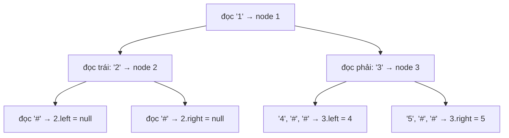

<!-- approaches: Preorder with null markers · Level order (BFS) -->
# 297. Serialize and Deserialize Binary Tree

**Hard** · String · Tree · Depth-First Search · Breadth-First Search · [LeetCode ↗](https://leetcode.com/problems/serialize-and-deserialize-binary-tree/) · Code: [SerializeAndDeserializeBinaryTree.java](SerializeAndDeserializeBinaryTree.java) · Tests: [SerializeAndDeserializeBinaryTreeTest.java](SerializeAndDeserializeBinaryTreeTest.java)

## Đề bài

Thiết kế cách **chuyển cây nhị phân thành chuỗi** (serialize) và **dựng lại cây từ chuỗi** (deserialize) — kết quả phải giống hệt cây ban đầu.

## Ý tưởng

> Một dãy duyệt bình thường (preorder, inorder…) **không đủ** để dựng lại cây — mất thông tin về hình dạng. Nhưng nếu ghi cả các **con rỗng** bằng một ký hiệu (`#`), thì preorder **xác định duy nhất** cây.

```
      1
     / \
    2   3          preorder có null:  1, 2, #, #, 3, 4, #, #, 5, #, #
       / \
      4   5
```



## Cách 1 — Preorder + đánh dấu null ⭐

**Deserialize** chỉ cần đọc token theo đúng thứ tự đã ghi: token đầu là gốc, rồi đệ quy dựng cây trái (tiêu thụ đúng số token của nó), rồi cây phải. Không cần biết trước kích thước cây con.

## Cách 2 — Theo tầng (BFS)

Giống định dạng LeetCode `[1,2,3,null,null,4,5]`. Khi dựng lại, mỗi node lấy ra khỏi hàng đợi "tiêu thụ" hai token kế tiếp làm con trái và phải.

## Bẫy & lưu ý

- Giá trị có thể **âm** và nhiều chữ số — cần dấu phân cách (`,`).
- Đừng dùng biến `static` để lưu trạng thái giữa các lần gọi.
- Với **BST** (bài 449) có thể bỏ ký hiệu null: preorder của BST đã đủ để dựng lại nhờ thứ tự giá trị.

## Bài liên quan

449 Serialize and Deserialize BST · 428 Serialize and Deserialize N-ary Tree · 105 Construct Binary Tree from Preorder and Inorder · 1028 Recover a Tree From Preorder Traversal.
