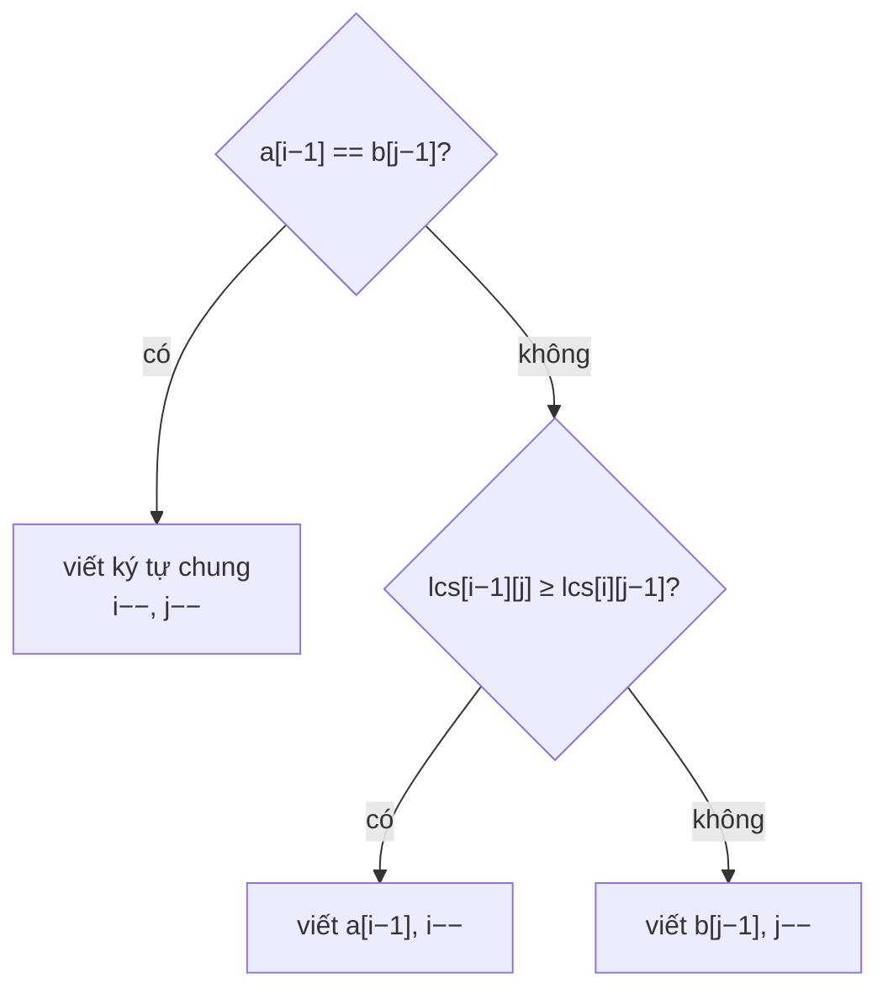

<!-- approaches: LCS table + walk back · DP storing whole strings -->
# 1092. Shortest Common Supersequence

**Hard** · String · Dynamic Programming · Longest Common Subsequence · [LeetCode ↗](https://leetcode.com/problems/shortest-common-supersequence/) · Code: [ShortestCommonSupersequence.java](ShortestCommonSupersequence.java) · Tests: [ShortestCommonSupersequenceTest.java](ShortestCommonSupersequenceTest.java)

## Đề bài

Tìm chuỗi **ngắn nhất** chứa cả `str1` và `str2` dưới dạng **dãy con**.

```
("abac", "cab") -> "cabac"
   abac:  _abac  ✓        cab:  cab__  ✓
```

## Ý tưởng

> Phần **chung** của hai chuỗi chỉ cần viết **một lần**. Phần chung dài nhất có thể chính là **LCS** (bài 1143).
> Độ dài đáp án = `|str1| + |str2| − LCS`. Để dựng chuỗi: đi ngược bảng LCS từ góc cuối —
> - ký tự bằng nhau (thuộc LCS) → viết một lần, lùi cả hai;
> - khác nhau → lùi theo hướng bảng LCS lớn hơn, viết ký tự của chuỗi vừa lùi.



`"abac"` và `"cab"`: LCS = `"ab"` (độ dài 2) → đáp án dài `4 + 3 − 2 = 5`.

| bước (đi ngược) | ký tự viết |
|---|---|
| c ≠ b → lùi str1 | c |
| a ≠ b → lùi str1 | a |
| b = b (LCS) | b |
| a = a (LCS) | a |
| còn "c" của str2 | c |

Đảo ngược: `"cabac"`.

## Cách 1 — Bảng LCS + đi ngược `O(m·n)` ⭐

## Cách 2 — DP lưu luôn chuỗi

Mỗi ô lưu chuỗi kết quả của cặp hậu tố. Dễ hiểu, nhưng sao chép chuỗi làm độ phức tạp tăng thêm một bậc.

## Bài liên quan

1143 Longest Common Subsequence · 72 Edit Distance · 583 Delete Operation for Two Strings · 943 Find the Shortest Superstring.
