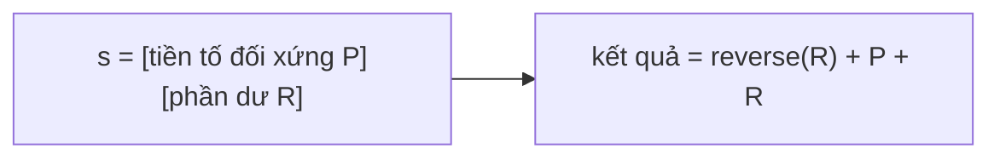

<!-- approaches: Brute force longest palindromic prefix · KMP failure function · Rolling hash -->
# 214. Shortest Palindrome

**Hard** · String · Rolling Hash · String Matching · Hash Function · [LeetCode ↗](https://leetcode.com/problems/shortest-palindrome/) · Code: [ShortestPalindrome.java](ShortestPalindrome.java) · Tests: [ShortestPalindromeTest.java](ShortestPalindromeTest.java)

## Đề bài

Chỉ được thêm ký tự vào **đầu** chuỗi. Tạo chuỗi đối xứng **ngắn nhất**.

```
"aacecaaa" -> "aaacecaaa"        "abcd" -> "dcbabcd"
```

## Ý tưởng

> Tìm **tiền tố đối xứng dài nhất** của `s`. Phần còn lại phía sau phải được "phản chiếu" lên đầu: đảo ngược nó và đặt trước `s`.

```
s = "aacecaa" + "a"      tiền tố đối xứng dài nhất: "aacecaa"
phần dư "a" đảo ngược → "a" + s = "aaacecaaa"
```



## Cách 1 — Thử từ dài tới ngắn `O(n²)`

## Cách 2 — KMP `O(n)` ⭐

Ghép `t = s + "#" + reverse(s)`. **Tiền tố dài nhất cũng là hậu tố** của `t` (giá trị cuối của bảng *failure function* KMP) chính là tiền tố đối xứng dài nhất của `s`:
- tiền tố của `t` là tiền tố của `s`;
- hậu tố của `t` là hậu tố của `reverse(s)` = tiền tố của `s` **đọc ngược**;
- trùng nhau ⇔ tiền tố đó đọc xuôi bằng đọc ngược.

Dấu `#` ngăn kết quả vượt quá độ dài `s`.

| t = "abab" + "#" + "baba" | |
|---|---|
| failure cuối | 3 → tiền tố "aba" đối xứng |
| kết quả | "b" + "abab" = "babab" |

## Cách 3 — Rolling hash

Duy trì hash của tiền tố đọc **xuôi** và đọc **ngược** cùng lúc; hai hash bằng nhau ⇒ (rất có thể) đối xứng — kiểm tra lại để loại va chạm.

## Bài liên quan

28 Find the Index of the First Occurrence (KMP) · 5 Longest Palindromic Substring · 459 Repeated Substring Pattern · 1392 Longest Happy Prefix.
