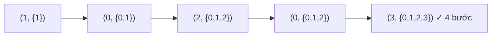

<!-- approaches: BFS over (node, visited mask) · Floyd-Warshall + bitmask DP (TSP) -->
# 847. Shortest Path Visiting All Nodes

**Hard** · Dynamic Programming · Bit Manipulation · Breadth-First Search · Graph Theory · [LeetCode ↗](https://leetcode.com/problems/shortest-path-visiting-all-nodes/) · Code: [ShortestPathVisitingAllNodes.java](ShortestPathVisitingAllNodes.java) · Tests: [ShortestPathVisitingAllNodesTest.java](ShortestPathVisitingAllNodesTest.java)

## Đề bài

Đồ thị vô hướng liên thông, `n ≤ 12` đỉnh. Tìm độ dài **đường đi ngắn nhất thăm mọi đỉnh** (được bắt đầu/kết thúc ở đâu cũng được, được đi lại đỉnh và cạnh).

```
    1
    |
2 — 0 — 3          -> 4   (1 → 0 → 2 → 0 → 3)
```

## Ý tưởng

> Vị trí hiện tại **chưa đủ** để mô tả trạng thái — còn phải biết **đã thăm những đỉnh nào**. Trạng thái = `(đỉnh hiện tại, tập đỉnh đã thăm)`, tập đỉnh mã hoá bằng **bitmask** (`n ≤ 12` → tối đa `12 · 4096` trạng thái).
> Mỗi cạnh dài 1 → **BFS** trên không gian trạng thái, bắt đầu **đồng thời từ mọi đỉnh** (được chọn điểm xuất phát tuỳ ý).



## Cách 1 — BFS trên (đỉnh, bitmask) ⭐

Trạng thái đầu tiên có bitmask đầy (`2ⁿ − 1`) cho đáp án. Đánh dấu `seen[đỉnh][mask]` để không thăm lại.

## Cách 2 — Floyd–Warshall + DP bitmask (TSP)

1. Tính khoảng cách ngắn nhất giữa mọi cặp đỉnh.
2. `dp[mask][v]` = đường ngắn nhất thăm **đúng** các đỉnh trong `mask`, kết thúc ở `v`. Chuyển: thêm một đỉnh `u` chưa thăm, cộng `dist[v][u]`.

Đây là lời giải kinh điển của **bài toán người du lịch** (Held–Karp) — đáng biết vì nó xuất hiện dưới nhiều vỏ bọc.

## Độ phức tạp

Cả hai `O(2ⁿ · n²)` — chỉ chạy được vì `n` nhỏ. Đề cho `n ≤ 12–20` là **dấu hiệu** của DP bitmask.

## Bài liên quan

980 Unique Paths III · 943 Find the Shortest Superstring (TSP trên chuỗi) · 1125 Smallest Sufficient Team · 864 Shortest Path to Get All Keys (BFS + bitmask).
