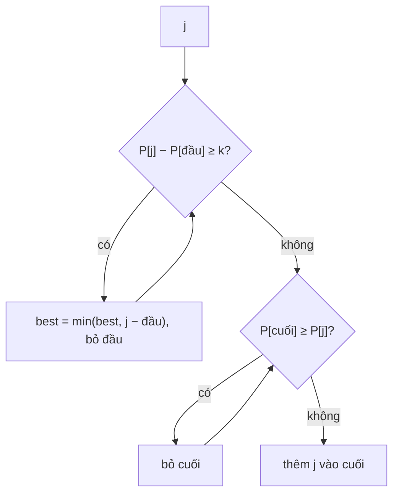

<!-- approaches: Prefix sums + monotonic deque -->
# 862. Shortest Subarray with Sum at Least K

**Hard** · Array · Binary Search · Queue · Sliding Window · [LeetCode ↗](https://leetcode.com/problems/shortest-subarray-with-sum-at-least-k/) · Code: [ShortestSubarrayWithSumAtLeastK.java](ShortestSubarrayWithSumAtLeastK.java) · Tests: [ShortestSubarrayWithSumAtLeastKTest.java](ShortestSubarrayWithSumAtLeastKTest.java)

## Đề bài

Tìm đoạn con liên tiếp **ngắn nhất** có tổng `≥ k`. Phần tử có thể **âm**.

```
[2,-1,2], k = 3 -> 3
```

## Ý tưởng

> Với số dương, cửa sổ trượt là đủ (bài 209). Có **số âm** thì cửa sổ trượt hỏng — thu hẹp bên trái có thể làm tổng **tăng**.
> Dùng prefix sum `P`: cần `i < j` gần nhau nhất với `P[j] − P[i] ≥ k`. Giữ **deque các chỉ số có `P` tăng dần**:
> - **Đầu deque:** nếu `P[j] − P[đầu] ≥ k` → ghi nhận độ dài rồi **bỏ đầu** (mọi `j` sau sẽ chỉ dài hơn với điểm đầu này).
> - **Cuối deque:** nếu `P[cuối] ≥ P[j]` → **bỏ cuối** (`j` vừa muộn hơn vừa nhỏ hơn — luôn là điểm bắt đầu tốt hơn).

`[2, −1, 2]`, `P = [0, 2, 1, 3]`, `k = 3`:

| j | P[j] | xử lý đầu | xử lý cuối | deque |
|---|---|---|---|---|
| 0 | 0 | | | [0] |
| 1 | 2 | 2 − 0 &lt; 3 | | [0, 1] |
| 2 | 1 | | bỏ 1 (2 ≥ 1) | [0, 2] |
| 3 | 3 | 3 − 0 ≥ 3 → **dài 3**, bỏ 0 | | [2, 3] |



## Lời giải — Deque đơn điệu `O(n)` ⭐

Prefix sum dùng `long` (tổng có thể vượt `int`).

## Bài liên quan

209 Minimum Size Subarray Sum (chỉ số dương) · 239 Sliding Window Maximum · 1499 Max Value of Equation.
