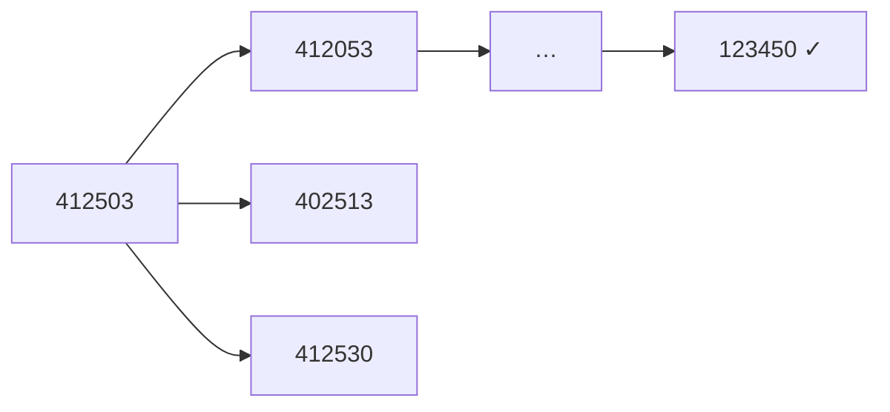

<!-- approaches: BFS over board states · A* with Manhattan distance -->
# 773. Sliding Puzzle

**Hard** · Array · Dynamic Programming · Backtracking · Breadth-First Search · [LeetCode ↗](https://leetcode.com/problems/sliding-puzzle/) · Code: [SlidingPuzzle.java](SlidingPuzzle.java) · Tests: [SlidingPuzzleTest.java](SlidingPuzzleTest.java)

## Đề bài

Bàn `2 × 3` có các ô số `1–5` và một ô trống `0`. Mỗi bước đổi ô trống với một ô kề. Ít nhất bao nhiêu bước để về `[[1,2,3],[4,5,0]]`? Không thể → `−1`.

```
4 1 2        4 1 2        4 1 2        0 1 2        1 0 2  …  1 2 3
5 0 3   ->   0 5 3   ->   …                                   4 5 0     (5 bước)
```

## Ý tưởng

> Coi **mỗi trạng thái bàn cờ là một đỉnh**, mỗi bước đi là một cạnh. "Ít bước nhất" trên đồ thị không trọng số → **BFS**. Chỉ có `6! = 720` trạng thái nên rất nhanh.
> Mã hoá bàn cờ thành chuỗi `"412503"` để dùng làm khoá trong `HashSet`.



Bảng láng giềng của ô trống theo chỉ số trong chuỗi:

```
 0 1 2        0: {1, 3}   1: {0, 2, 4}   2: {1, 5}
 3 4 5        3: {0, 4}   4: {1, 3, 5}   5: {2, 4}
```

## Cách 1 — BFS trên không gian trạng thái ⭐

## Cách 2 — A*

Ưu tiên trạng thái có `số bước đã đi + ước lượng còn lại` nhỏ nhất. Ước lượng = tổng **khoảng cách Manhattan** của các ô tới vị trí đích — không bao giờ ước lượng quá (mỗi bước chỉ dời một ô đi một ô), nên A* vẫn cho kết quả tối ưu và thường thăm ít trạng thái hơn BFS. Với bàn lớn (8-puzzle, 15-puzzle) thì A* là bắt buộc.

## Vì sao có trạng thái không giải được?

Mỗi bước đổi chỗ giữ nguyên **tính chẵn lẻ** của một đại lượng (số nghịch thế kết hợp vị trí ô trống) → một nửa số trạng thái không bao giờ tới được đích. BFS phát hiện tự nhiên: duyệt hết mà không gặp đích.

## Bài liên quan

752 Open the Lock · 127 Word Ladder · 1263 Minimum Moves to Move a Box to Their Target Location.
