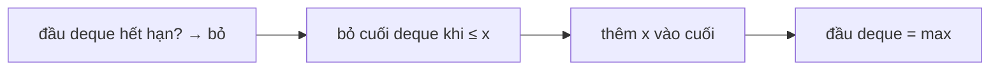

<!-- approaches: Brute force per window · Monotonic deque · Block prefix/suffix maxima -->
# 239. Sliding Window Maximum

**Hard** · Array · Queue · Sliding Window · Heap (Priority Queue) · [LeetCode ↗](https://leetcode.com/problems/sliding-window-maximum/) · Code: [SlidingWindowMaximum.java](SlidingWindowMaximum.java) · Tests: [SlidingWindowMaximumTest.java](SlidingWindowMaximumTest.java)

## Đề bài

Cửa sổ dài `k` trượt từ trái sang phải; trả về **giá trị lớn nhất** của mỗi cửa sổ.

```
[1,3,-1,-3,5,3,6,7], k = 3 -> [3,3,5,5,6,7]
```

## Ý tưởng

> **Deque đơn điệu giảm** (lưu chỉ số). Khi số mới `x` tới, mọi số **nhỏ hơn hoặc bằng** `x` ở cuối deque **không bao giờ** còn là max được nữa (vì `x` lớn hơn và ở lại cửa sổ lâu hơn) → bỏ đi. Đầu deque luôn là max của cửa sổ; nó rời đi khi trượt ra khỏi cửa sổ.

| i | x | deque (giá trị) | max |
|---|---|---|---|
| 0 | 1 | 1 | |
| 1 | 3 | 3 | |
| 2 | −1 | 3 −1 | 3 |
| 3 | −3 | 3 −1 −3 | 3 |
| 4 | 5 | 5 (3 hết hạn, −1 −3 bị đẩy) | 5 |
| 5 | 3 | 5 3 | 5 |
| 6 | 6 | 6 | 6 |
| 7 | 7 | 7 | 7 |



## Cách 1 — Vét cạn `O(n·k)`

## Cách 2 — Deque đơn điệu `O(n)` ⭐

Mỗi chỉ số vào và ra deque tối đa một lần.

## Cách 3 — Max tiền tố / hậu tố theo khối `O(n)`

Chia mảng thành các khối dài `k`. Mỗi cửa sổ phủ **phần cuối** của một khối và **phần đầu** của khối kế tiếp → `max = max(suffixMax[i], prefixMax[i + k − 1])`. Không cần cấu trúc dữ liệu — mẹo hay để kể.

## Bài liên quan

1438 Longest Continuous Subarray With Absolute Diff ≤ Limit · 862 Shortest Subarray with Sum at Least K · 1696 Jump Game VI · 155 Min Stack.
