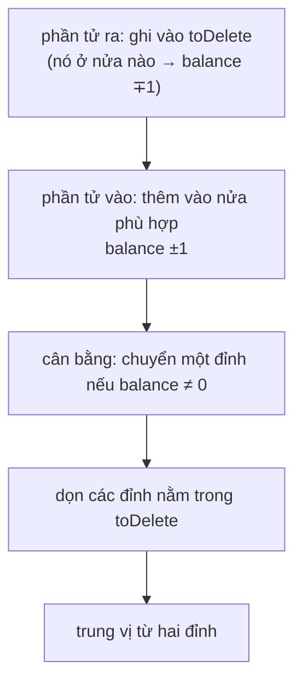

<!-- approaches: Two heaps with lazy deletion · Sorted list with binary insertion -->
# 480. Sliding Window Median

**Hard** · Array · Hash Table · Sliding Window · Heap (Priority Queue) · [LeetCode ↗](https://leetcode.com/problems/sliding-window-median/) · Code: [SlidingWindowMedian.java](SlidingWindowMedian.java) · Tests: [SlidingWindowMedianTest.java](SlidingWindowMedianTest.java)

## Đề bài

Trả về **trung vị** của mỗi cửa sổ dài `k` khi trượt qua mảng.

```
[1,3,-1,-3,5,3,6,7], k = 3 -> [1,-1,-1,3,5,6]
```

## Ý tưởng

> Kết hợp **295 Find Median from Data Stream** (hai heap) với cửa sổ trượt. Khó khăn: phải **xoá** phần tử rời cửa sổ, mà heap không xoá phần tử ở giữa được.
> **Xoá trễ (lazy deletion):** chỉ ghi phần tử cần xoá vào một bảng đếm; khi nó nổi lên **đỉnh** heap thì mới thật sự bỏ đi. Đồng thời theo dõi `balance` — chênh lệch **kích thước thật** giữa hai nửa — để cân bằng lại đúng.



## Cách 1 — Danh sách đã sắp xếp `O(n·k)` ⭐ (dễ đúng)

Chèn và xoá bằng tìm kiếm nhị phân; trung vị là phần tử (hoặc hai phần tử) ở giữa. Chèn/xoá trong `ArrayList` tốn `O(k)` nhưng rất nhanh trên thực tế.

## Cách 2 — Hai heap + xoá trễ `O(n log n)`

Bất biến: (kích thước thật) `low` bằng `high` hoặc nhiều hơn một. Chỉ **đỉnh** của mỗi heap cần là phần tử thật — các phần tử "đã chết" nằm sâu bên trong không ảnh hưởng tới trung vị.

## Bẫy & lưu ý

- Trung bình hai số `int` lớn có thể tràn → cộng bằng `long` rồi chia `2.0` (test có ca `[MAX, MAX]`).

## Bài liên quan

295 Find Median from Data Stream · 239 Sliding Window Maximum · 2009 Minimum Number of Operations to Make Array Continuous.
