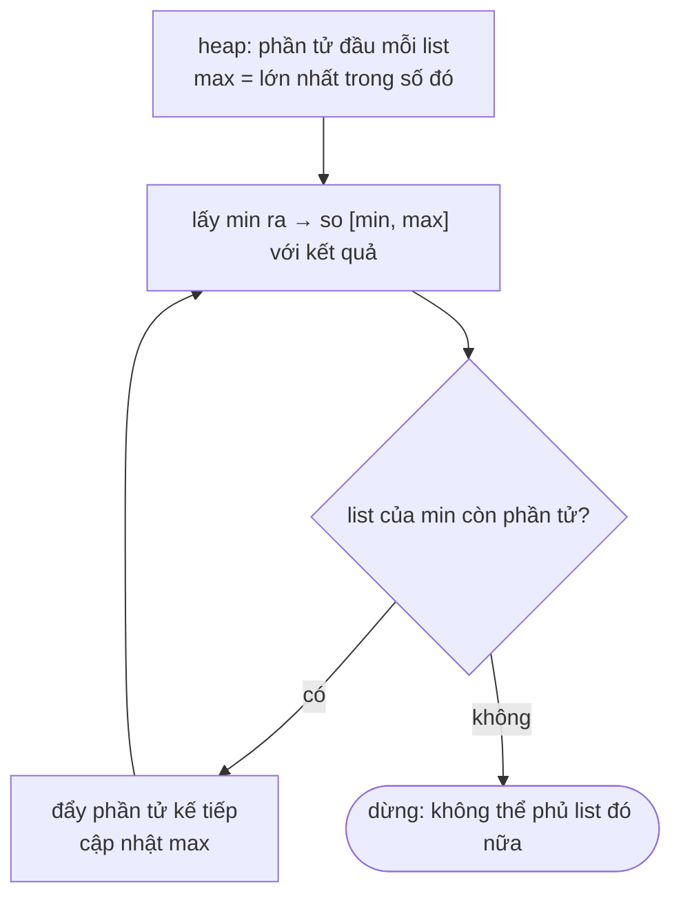

<!-- approaches: Min-heap of one pointer per list · Merge all + sliding window -->
# 632. Smallest Range Covering Elements from K Lists

**Hard** · Array · Hash Table · Greedy · Sliding Window · [LeetCode ↗](https://leetcode.com/problems/smallest-range-covering-elements-from-k-lists/) · Code: [SmallestRangeCoveringElementsFromKLists.java](SmallestRangeCoveringElementsFromKLists.java) · Tests: [SmallestRangeCoveringElementsFromKListsTest.java](SmallestRangeCoveringElementsFromKListsTest.java)

## Đề bài

`k` danh sách đã sắp xếp. Tìm khoảng `[a, b]` **ngắn nhất** chứa ít nhất một số của **mỗi** danh sách (bằng nhau thì lấy `a` nhỏ hơn).

```
[4,10,15,24,26], [0,9,12,20], [5,18,22,30] -> [20,24]   (24, 20, 22)
```

## Ý tưởng

> Giữ **một con trỏ trên mỗi danh sách**. Các phần tử đang được trỏ tạo thành khoảng `[min, max]` — luôn chứa đủ `k` danh sách.
> Muốn thu hẹp, chỉ có một cách: **tiến con trỏ đang giữ `min`** (tiến con trỏ khác chỉ làm `max` lớn thêm). Dùng **min-heap** để biết ngay ai đang là `min`, và một biến theo dõi `max`.



| heap (min…) | max | khoảng | tốt nhất |
|---|---|---|---|
| 0 4 5 | 5 | [0,5] | [0,5] |
| 4 5 9 | 9 | [4,9] | [0,5] |
| 5 9 10 | 10 | [5,10] | |
| 9 10 18 | 18 | … | |
| … | | | |
| 20 22 24 | 24 | [20,24] | **[20,24]** |

## Cách 1 — Min-heap `O(N log k)` ⭐

Giống bài 23 Merge k Sorted Lists, chỉ thêm việc theo dõi `max`.

## Cách 2 — Gộp + cửa sổ trượt `O(N log N)`

Gộp mọi phần tử kèm nhãn danh sách, sắp xếp, rồi tìm **cửa sổ ngắn nhất phủ đủ `k` nhãn** — chính là bài 76 Minimum Window Substring.

## Bài liên quan

23 Merge k Sorted Lists · 76 Minimum Window Substring · 378 Kth Smallest Element in a Sorted Matrix.
