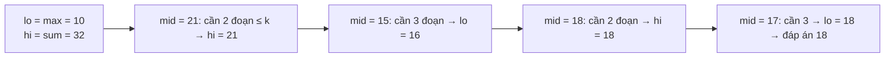

<!-- approaches: Binary search on the answer + greedy check · DP over prefixes -->
# 410. Split Array Largest Sum

**Hard** · Array · Binary Search · Dynamic Programming · Greedy · [LeetCode ↗](https://leetcode.com/problems/split-array-largest-sum/) · Code: [SplitArrayLargestSum.java](SplitArrayLargestSum.java) · Tests: [SplitArrayLargestSumTest.java](SplitArrayLargestSumTest.java)

## Đề bài

Chia mảng thành `k` đoạn liên tiếp (khác rỗng) sao cho **tổng lớn nhất** trong các đoạn là **nhỏ nhất**.

```
[7,2,5,10,8], k = 2 -> 18    [7,2,5] (14) | [10,8] (18)
```

## Ý tưởng

> Đảo câu hỏi: "Với giới hạn `X`, có chia được thành **≤ k** đoạn mà đoạn nào cũng có tổng `≤ X` không?"
> - Trả lời được **tham lam**: cứ cộng dồn, khi thêm số tiếp theo vượt `X` thì mở đoạn mới.
> - Câu trả lời **đơn điệu** theo `X` (giới hạn càng lớn càng dễ) → **tìm kiếm nhị phân trên đáp án**, trong khoảng `[max(nums), sum(nums)]`.



Kiểm tra `X = 18` trên `[7,2,5,10,8]`: `7+2+5 = 14`, thêm 10 thành 24 > 18 → đoạn mới `10+8 = 18` → 2 đoạn ✓.

## Cách 1 — Nhị phân trên đáp án + tham lam `O(n log Σ)` ⭐

Khuôn "**minimize the maximum**" — dùng lại ở 875 Koko Eating Bananas, 1011 Capacity To Ship Packages, 1482 Minimum Number of Days to Make m Bouquets.

## Cách 2 — DP `O(k·n²)`

`dp[j][i]` = tốt nhất khi chia `i` số đầu thành `j` đoạn = `min over p of max(dp[j−1][p], tổng(p..i−1))`. Chậm hơn nhưng không cần nhận ra tính đơn điệu.

## Bài liên quan

875 Koko Eating Bananas · 1011 Capacity To Ship Packages Within D Days · 1231 Divide Chocolate · 2064 Minimized Maximum of Products Distributed to Any Store.
