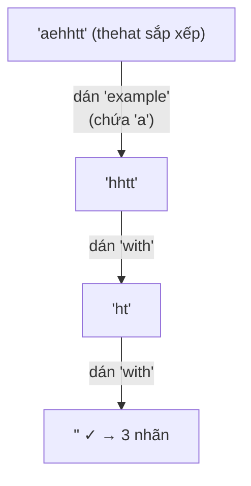

<!-- approaches: Memoized DFS over remaining letter counts · BFS over bitmask of covered positions -->
# 691. Stickers to Spell Word

**Hard** · Array · Hash Table · String · Dynamic Programming · [LeetCode ↗](https://leetcode.com/problems/stickers-to-spell-word/) · Code: [StickersToSpellWord.java](StickersToSpellWord.java) · Tests: [StickersToSpellWordTest.java](StickersToSpellWordTest.java)

## Đề bài

Có các nhãn dán (mỗi loại dùng bao nhiêu lần cũng được), được cắt rời từng chữ. Cần **ít nhãn nhất** để ghép thành `target`. Không thể → `−1`.

```
["with","example","science"], "thehat" -> 3   (2 × "with" + 1 × "example")
```

## Ý tưởng

> Thứ tự chữ không quan trọng → trạng thái = **các chữ còn thiếu** của `target` (viết dưới dạng chuỗi đã sắp xếp để làm khoá). Thử dán từng loại nhãn, đệ quy trên phần còn thiếu, **ghi nhớ** theo trạng thái.
> **Cắt tỉa then chốt:** chữ đầu tiên còn thiếu **chắc chắn** phải do một nhãn nào đó cung cấp → chỉ thử những nhãn **chứa chữ đó**. Không mất lời giải tối ưu, nhưng loại bỏ rất nhiều nhánh vô ích (và các hoán vị thứ tự dán).



## Cách 1 — DFS + memo trên chữ còn thiếu ⭐

## Cách 2 — BFS trên bitmask vị trí đã phủ

`target` dài tối đa 15 → trạng thái là `mask` 15 bit (vị trí nào đã có chữ). Mỗi cạnh là "dán một nhãn" (mỗi chữ của nhãn phủ vị trí **chưa phủ** đầu tiên có chữ đó). BFS cho số nhãn ít nhất. Tối đa `2¹⁵` trạng thái × số loại nhãn.

## Bài liên quan

322 Coin Change · 1125 Smallest Sufficient Team · 847 Shortest Path Visiting All Nodes (BFS trên bitmask) · 383 Ransom Note.
