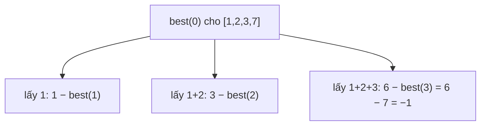

<!-- approaches: Memoized minimax on score difference · Bottom-up DP from the end -->
# 1406. Stone Game III

**Hard** · Array · Math · Dynamic Programming · Minimax · [LeetCode ↗](https://leetcode.com/problems/stone-game-iii/) · Code: [StoneGameIII.java](StoneGameIII.java) · Tests: [StoneGameIIITest.java](StoneGameIIITest.java)

## Đề bài

Dãy đá có giá trị (có thể âm). Alice và Bob luân phiên lấy **1, 2 hoặc 3** viên **từ đầu dãy**; mỗi người muốn tổng của mình lớn nhất. Ai thắng?

```
[1,2,3,7]  -> "Bob"     (Alice lấy gì thì Bob cũng lấy được viên 7)
[1,2,3,-9] -> "Alice"   (Alice lấy cả 1,2,3, Bob buộc phải lấy −9)
```

## Ý tưởng

> Trò chơi **tổng bằng không**: thay vì theo dõi hai điểm số, chỉ theo dõi **hiệu** (điểm mình − điểm đối thủ).
> `best(i)` = hiệu tốt nhất mà **người đang đi** đạt được từ viên `i` trở đi. Lấy `k` viên có tổng `sum`, sau đó đối thủ đi và đạt `best(i + k)` (theo góc nhìn **của họ**), nên:
> `best(i) = max over k of (sum − best(i + k))`.



Tính từ cuối `[1, 2, 3, 7]`:

| i | best(i) |
|---|---|
| 3 | 7 |
| 2 | max(3 − 7, 3 + 7 − 0) = 10 |
| 1 | max(2 − 10, 5 − 7, 12 − 0) = 12 |
| 0 | max(1 − 12, 3 − 10, 6 − 7) = **−1** → Bob |

## Cách 1 — Minimax có nhớ ⭐

Kỹ thuật "**hiệu điểm**" biến minimax hai người thành một hàm `max` duy nhất — dùng cho cả họ Stone Game (877, 1140, 1406, 1563).

## Cách 2 — DP từ cuối, bộ nhớ `O(1)`

`best(i)` chỉ cần `best(i+1)`, `best(i+2)`, `best(i+3)` → mảng xoay vòng 4 ô.

## Bẫy & lưu ý

- Có giá trị âm nên **bắt buộc** lấy ít nhất một viên mỗi lượt có thể có lợi hoặc có hại — đừng giả định lấy nhiều luôn tốt.

## Bài liên quan

877 Stone Game · 1140 Stone Game II · 486 Predict the Winner · 292 Nim Game.
