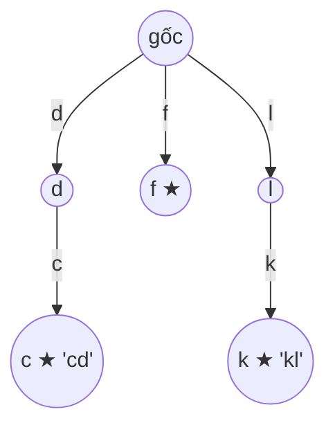

<!-- approaches: Trie of reversed words · Brute force suffix check -->
# 1032. Stream of Characters

**Hard** · Array · String · Design · Trie · [LeetCode ↗](https://leetcode.com/problems/stream-of-characters/) · Code: [StreamOfCharacters.java](StreamOfCharacters.java) · Tests: [StreamOfCharactersTest.java](StreamOfCharactersTest.java)

## Đề bài

`StreamChecker(words)`; mỗi lần `query(letter)` nối thêm một chữ vào **luồng** và trả `true` nếu có **hậu tố** của luồng trùng với một từ trong danh sách.

```
words = ["cd","f","kl"]
query a b c d → true ở 'd' ("cd") · query f → true · … query l → true ("kl")
```

## Ý tưởng

> Câu hỏi luôn là về **phần cuối** của luồng → đọc luồng **từ chữ mới nhất lùi về trước**. Muốn so khớp hiệu quả theo chiều ngược, dựng **Trie của các từ viết ngược**.
> Mỗi truy vấn: đi trong trie theo các chữ `stream[last], stream[last−1], …`; gặp node đánh dấu kết thúc từ → `true`; đi lạc khỏi trie → `false`.



Luồng `"…abcd"`: đi `d → c` → gặp ★ → `true`.

## Cách 1 — Trie các từ đảo ngược ⭐

Chi phí mỗi truy vấn ≤ **độ dài từ dài nhất** (không phụ thuộc độ dài luồng hay số lượng từ). Chỉ cần giữ `maxLength` ký tự cuối của luồng.

## Cách 2 — So từng từ với đuôi luồng

Mỗi truy vấn tốn tổng độ dài mọi từ. Đơn giản, chậm khi có nhiều từ.

## Câu hỏi mở rộng

**Aho–Corasick** (trie + liên kết "thất bại") xử lý mỗi chữ trong `O(1)` khấu hao — lời giải tối ưu cho đối sánh nhiều mẫu trên luồng.

## Bài liên quan

208 Implement Trie · 211 Design Add and Search Words · 212 Word Search II · 745 Prefix and Suffix Search.
