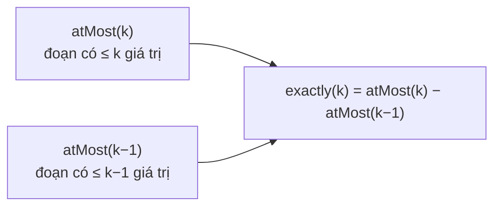

<!-- approaches: Brute force with a set · atMost(k) - atMost(k - 1) with sliding windows -->
# 992. Subarrays with K Different Integers

**Hard** · Array · Hash Table · Sliding Window · Counting · [LeetCode ↗](https://leetcode.com/problems/subarrays-with-k-different-integers/) · Code: [SubarraysWithKDifferentIntegers.java](SubarraysWithKDifferentIntegers.java) · Tests: [SubarraysWithKDifferentIntegersTest.java](SubarraysWithKDifferentIntegersTest.java)

## Đề bài

Đếm số **đoạn con** có **đúng `k`** giá trị khác nhau.

```
[1,2,1,2,3], k = 2 -> 7:  [1,2] [2,1] [1,2] [2,3] [1,2,1] [2,1,2] [1,2,1,2]
```

## Ý tưởng

> "**Đúng** k" khó trượt cửa sổ: khi số giá trị khác nhau bằng `k`, chưa biết nên mở rộng hay co lại. Nhưng "**tối đa** k" thì dễ — và
> **đúng k = tối đa k − tối đa (k−1)**.



**Đếm `atMost(k)` bằng cửa sổ trượt:** với mỗi đầu phải `right`, co `left` tới khi cửa sổ còn `≤ k` giá trị. Khi đó **mọi** điểm bắt đầu trong `[left, right]` đều cho đoạn hợp lệ → cộng `right − left + 1`.

`[1,2,1,2,3]`, `atMost(2)`:

| right | cửa sổ | cộng |
|---|---|---|
| 0 | [1] | 1 |
| 1 | [1,2] | 2 |
| 2 | [1,2,1] | 3 |
| 3 | [1,2,1,2] | 4 |
| 4 | co tới [2,3] | 2 |
| | | **12** |

`atMost(1)` = 5 (năm đoạn một phần tử) → đáp án `12 − 5 = 7` ✓.

## Cách 1 — Vét cạn `O(n²)`

## Cách 2 — Hiệu hai cửa sổ "tối đa" `O(n)` ⭐

Mẹo "đúng = tối đa(k) − tối đa(k−1)" dùng lại ở 1248 Count Number of Nice Subarrays, 930 Binary Subarrays With Sum.

## Bài liên quan

340 Longest Substring with At Most K Distinct Characters · 904 Fruit Into Baskets · 930 Binary Subarrays With Sum · 1248 Count Number of Nice Subarrays.
