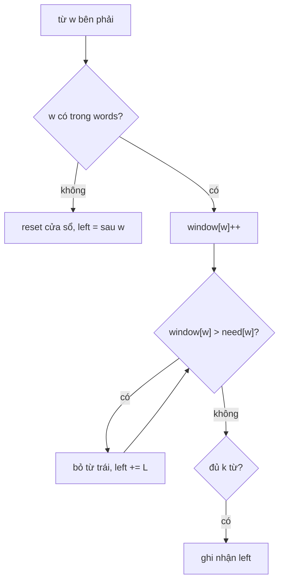

<!-- approaches: Sliding window per offset with word counts -->
# 30. Substring with Concatenation of All Words

**Hard** · Hash Table · String · Sliding Window · [LeetCode ↗](https://leetcode.com/problems/substring-with-concatenation-of-all-words/) · Code: [SubstringWithConcatenationOfAllWords.java](SubstringWithConcatenationOfAllWords.java) · Tests: [SubstringWithConcatenationOfAllWordsTest.java](SubstringWithConcatenationOfAllWordsTest.java)

## Đề bài

Các từ trong `words` **dài bằng nhau**. Tìm mọi vị trí bắt đầu của chuỗi con trong `s` là phép ghép **tất cả** các từ theo thứ tự bất kỳ (mỗi từ đúng số lần xuất hiện).

```
s = "barfoofoobarthefoobarman", words = [bar, foo, the] -> [6, 9, 12]
       foobarthe / barthefoo / thefoobar
```

## Ý tưởng — cửa sổ trượt theo "ô từ"

> Mọi từ dài `L` → chia `s` thành các **ô** dài `L`. Chỉ có `L` cách chia (bắt đầu tại `0, 1, …, L−1`). Trên mỗi cách chia, chạy **cửa sổ trượt** mà đơn vị là **một từ**:
> - thêm từ bên phải;
> - từ **không có** trong `words` → xoá sạch cửa sổ, bắt đầu lại sau nó;
> - từ bị dùng **quá số lần** → bỏ dần từ bên trái tới khi hết thừa;
> - đủ `k` từ → ghi nhận vị trí trái.

```
offset 0: bar|foo|foo|bar|the|foo|bar|man
               [foo|bar|the]           → 6
                   [bar|the|foo]       → 9
                       [the|foo|bar]   → 12
```



## Lời giải `O(n · L)` ⭐

So với vét cạn `O(n · k · L)` (với mỗi vị trí cắt `k` từ rồi so bảng đếm), cửa sổ trượt dùng lại công việc giữa các vị trí liên tiếp trên cùng một offset.

## Bài liên quan

76 Minimum Window Substring · 438 Find All Anagrams in a String · 567 Permutation in String.
