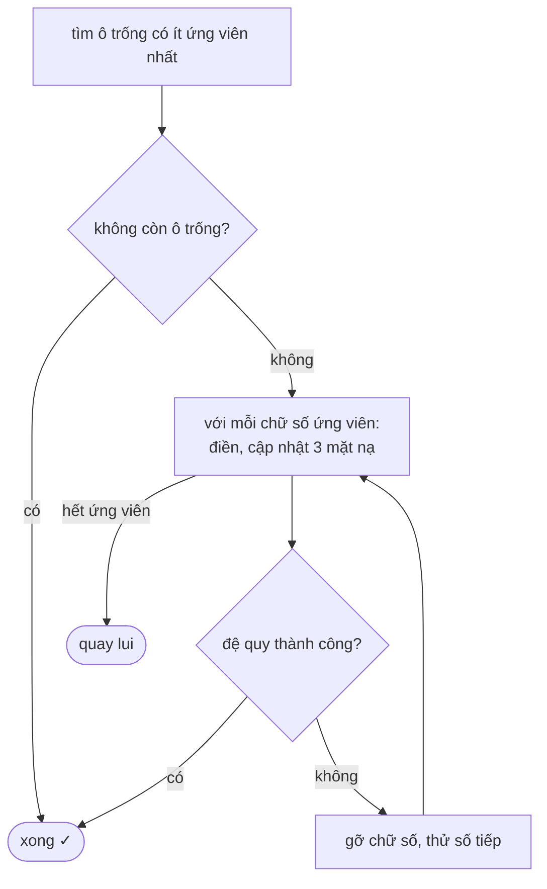

<!-- approaches: Backtracking cell by cell · Backtracking with bitmasks and the most constrained cell first -->
# 37. Sudoku Solver

**Hard** · Array · Hash Table · Backtracking · Matrix · [LeetCode ↗](https://leetcode.com/problems/sudoku-solver/) · Code: [SudokuSolver.java](SudokuSolver.java) · Tests: [SudokuSolverTest.java](SudokuSolverTest.java)

## Đề bài

Giải Sudoku 9×9 **tại chỗ** (`'.'` là ô trống). Đề đảm bảo có đúng một lời giải.

## Ý tưởng

> **Backtracking**: chọn một ô trống, thử từng chữ số hợp lệ, đệ quy; nếu đi vào ngõ cụt thì xoá và thử chữ số khác.
> Hai cải tiến biến lời giải từ "chạy được" thành "chạy nhanh":
> 1. **Bitmask** cho mỗi hàng/cột/ô 3×3 → kiểm tra hợp lệ `O(1)` (như bài 36).
> 2. **Ô bị ràng buộc nhiều nhất trước** (ít ứng viên nhất) — nếu ô nào chỉ còn 1 khả năng thì điền ngay, còn 0 thì quay lui ngay.

Ứng viên của ô `(r, c)`: `~(rows[r] | cols[c] | boxes[b]) & 0x1FF` — 9 bit, bit bật là chữ số còn dùng được.

## Cách 1 — Backtracking tuần tự

Đi lần lượt 81 ô, kiểm tra bằng cách quét hàng/cột/ô. Đúng, nhưng có thể chậm với đề khó (test thứ ba là một đề "khó nhất thế giới").

## Cách 2 — Bitmask + ô ít ứng viên nhất ⭐

Heuristic "**Minimum Remaining Values**" là kỹ thuật chuẩn của bài toán thoả mãn ràng buộc (CSP).

## Bài liên quan

36 Valid Sudoku · 51 N-Queens · 79 Word Search · 1240 Tiling a Rectangle with the Fewest Squares.
