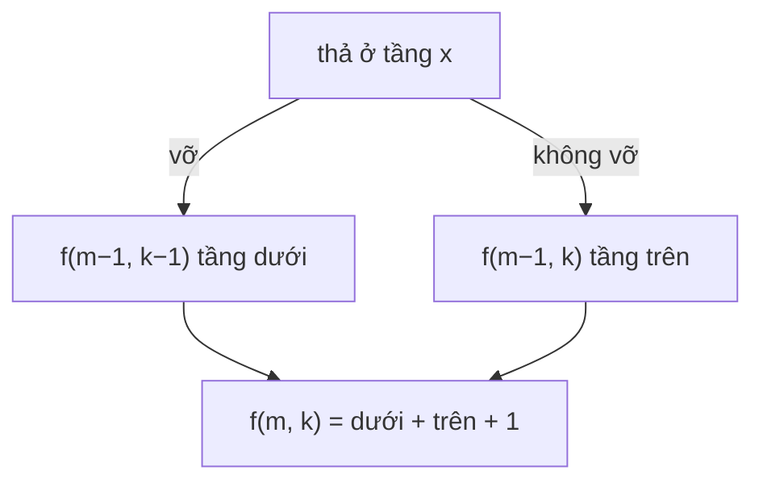

<!-- approaches: DP on moves: floors coverable with m moves and k eggs · Binary search DP -->
# 887. Super Egg Drop

**Hard** · Math · Binary Search · Dynamic Programming · [LeetCode ↗](https://leetcode.com/problems/super-egg-drop/) · Code: [SuperEggDrop.java](SuperEggDrop.java) · Tests: [SuperEggDropTest.java](SuperEggDropTest.java)

## Đề bài

Có `k` quả trứng giống nhau và toà nhà `n` tầng. Tồn tại tầng `f` (`0 ≤ f ≤ n`): thả từ trên `f` thì vỡ, từ `f` trở xuống thì không. Tìm số lần thả **ít nhất** để chắc chắn xác định `f` trong trường hợp xấu nhất.

```
k = 1, n = 2 -> 2     (chỉ một quả: phải thử từng tầng từ dưới lên)
k = 2, n = 100 -> 14  (bài đố kinh điển)
```

## Ý tưởng — đảo ngược câu hỏi

> Thay vì "`n` tầng cần bao nhiêu lần thả?", hỏi: **với `m` lần thả và `k` quả trứng, xác định được tối đa bao nhiêu tầng?** — gọi là `f(m, k)`.
> Thả một quả ở tầng nào đó:
> - **vỡ** → còn `m−1` lần, `k−1` quả → xử lý được `f(m−1, k−1)` tầng **bên dưới**;
> - **không vỡ** → còn `m−1` lần, `k` quả → xử lý được `f(m−1, k)` tầng **bên trên**;
> - cộng thêm chính tầng vừa thả.
>
> **`f(m, k) = f(m−1, k−1) + f(m−1, k) + 1`**. Đáp án là `m` nhỏ nhất với `f(m, k) ≥ n`.

| m | k = 1 | k = 2 | k = 3 |
|---|---|---|---|
| 1 | 1 | 1 | 1 |
| 2 | 2 | 3 | 3 |
| 3 | 3 | 6 | 7 |
| 4 | 4 | 10 | **14** |



## Cách 1 — DP theo số lần thả `O(k log n)` ⭐

Một mảng `f[e]`, cập nhật `e` **giảm dần** để `f[e−1]` vẫn là giá trị của `m−1`. Với `k ≥ 2`, `m` chỉ khoảng `O(√n)` hoặc ít hơn.

## Cách 2 — DP cổ điển + tìm kiếm nhị phân `O(k·n·log n)`

`dp[e][f] = 1 + min_x max(dp[e−1][x−1], dp[e][f−x])`. Hàm thứ nhất tăng theo `x`, hàm thứ hai giảm → điểm tối ưu ở chỗ chúng giao nhau, tìm bằng nhị phân. Vét `x` tuyến tính là `O(k·n²)` — quá chậm với `n = 10⁴`.

## Bài liên quan

1884 Egg Drop With 2 Eggs and N Floors · 375 Guess Number Higher or Lower II · 312 Burst Balloons.
