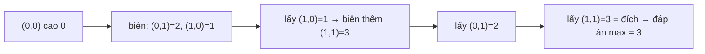

<!-- approaches: Dijkstra on the max height · Binary search + BFS · Union-find in height order -->
# 778. Swim in Rising Water

**Hard** · Array · Binary Search · Depth-First Search · Breadth-First Search · [LeetCode ↗](https://leetcode.com/problems/swim-in-rising-water/) · Code: [SwimInRisingWater.java](SwimInRisingWater.java) · Tests: [SwimInRisingWaterTest.java](SwimInRisingWaterTest.java)

## Đề bài

Lưới `n × n`, `grid[i][j]` là độ cao (một hoán vị của `0 … n²−1`). Tại thời điểm `t` mực nước là `t`; chỉ bơi được giữa hai ô kề nhau nếu **cả hai** có độ cao `≤ t`. Thời gian sớm nhất để bơi từ `(0,0)` tới `(n−1,n−1)`?

```
0 2
1 3      -> 3   (phải chờ tới khi ô đích 3 ngập)
```

## Ý tưởng

> Thời gian cần cho một đường đi = **ô cao nhất trên đường đó**. Cần tìm đường có "ô cao nhất" **nhỏ nhất** (bài toán **minimax path**).
> Dijkstra vẫn dùng được nếu thay "tổng trọng số" bằng "**max** trọng số": luôn mở rộng ô thấp nhất ở biên đang ngập.



## Cách 1 — Dijkstra theo max `O(n² log n)` ⭐

Giá trị của một ô khi đưa vào heap = `max(giá trị ô hiện tại, độ cao ô mới)`.

## Cách 2 — Tìm kiếm nhị phân đáp án + BFS

"Với mực nước `t`, có bơi tới đích được không?" là hàm **đơn điệu** theo `t` (nước càng cao càng dễ) → tìm nhị phân `t` nhỏ nhất. Mỗi lần kiểm tra là một BFS chỉ đi qua ô `≤ t`.

## Cách 3 — Union-Find theo thứ tự độ cao

Tăng nước từng mức; ô có độ cao `t` ngập ở thời điểm `t` → hợp nhất với các ô kề đã ngập. Thời điểm đầu tiên `(0,0)` và đích chung một tập là đáp án. Độ cao là hoán vị nên mỗi mức chỉ ngập đúng một ô.

## Bài liên quan

1631 Path With Minimum Effort (cùng dạng minimax) · 743 Network Delay Time · 1102 Path With Maximum Minimum Value · 407 Trapping Rain Water II.
