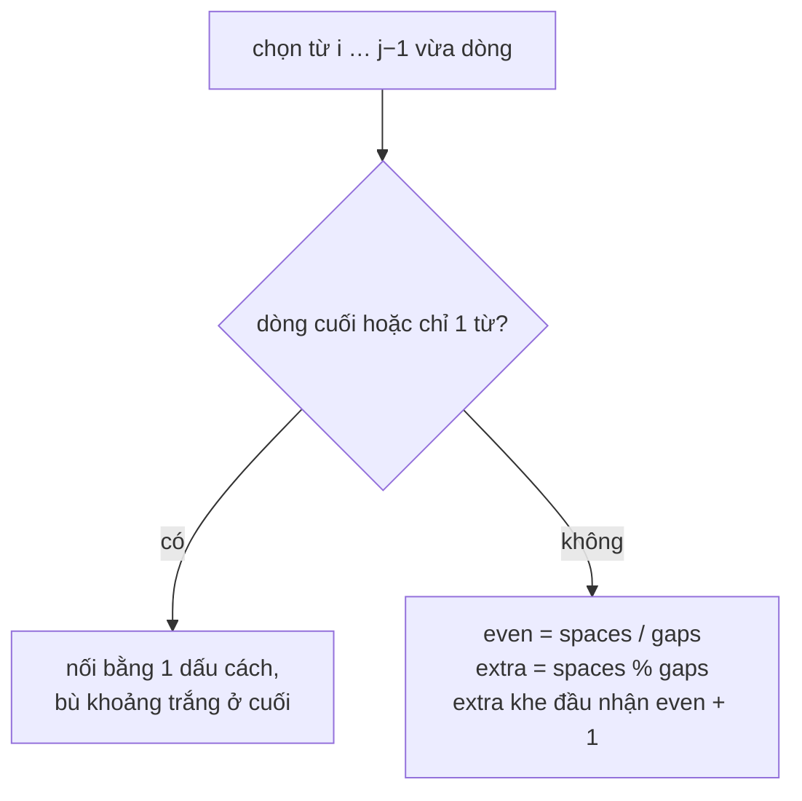

<!-- approaches: Greedy line packing + space distribution -->
# 68. Text Justification

**Hard** · Array · String · Simulation · [LeetCode ↗](https://leetcode.com/problems/text-justification/) · Code: [TextJustification.java](TextJustification.java) · Tests: [TextJustificationTest.java](TextJustificationTest.java)

## Đề bài

Căn đều hai bên (justify) một danh sách từ thành các dòng dài **đúng** `maxWidth`:
- xếp **nhiều từ nhất** có thể vào mỗi dòng (tham lam);
- chia đều khoảng trắng thừa giữa các từ; không chia hết thì các khe **bên trái** nhận nhiều hơn;
- **dòng cuối** và dòng chỉ có **một từ** thì căn trái, bù khoảng trắng ở cuối.

```
"This    is    an"
"example  of text"
"justification.  "
```

## Ý tưởng

> Bài này **không có thuật toán khó** — nó kiểm tra khả năng cài đặt cẩn thận nhiều trường hợp. Chia thành hai bước rõ ràng cho mỗi dòng:
> 1. **Chọn từ:** thêm từ khi `tổng độ dài chữ + số khe (1 dấu cách mỗi khe) ≤ maxWidth`.
> 2. **Phân bổ khoảng trắng:** `spaces = maxWidth − tổng chữ`, `gaps = số từ − 1`; mỗi khe được `spaces / gaps`, `spaces % gaps` khe đầu được thêm 1.



Dòng 1: `This is an` → chữ dài 8, `spaces = 8`, `gaps = 2` → mỗi khe 4: `"This····is····an"`.
Dòng 2: `example of text` → chữ 13, `spaces = 3`, `gaps = 2` → 2 và 1: `"example··of·text"`.

## Lời giải — Tham lam + phân bổ ⭐

Test kiểm tra thêm các **bất biến** trên dữ liệu ngẫu nhiên: mọi dòng dài đúng `maxWidth`, không bắt đầu bằng dấu cách, và ghép lại đúng thứ tự các từ.

## Bài liên quan

68 là bài "mô phỏng" kinh điển — cùng nhóm với 6 Zigzag Conversion, 54 Spiral Matrix, 1592 Rearrange Spaces Between Words.
