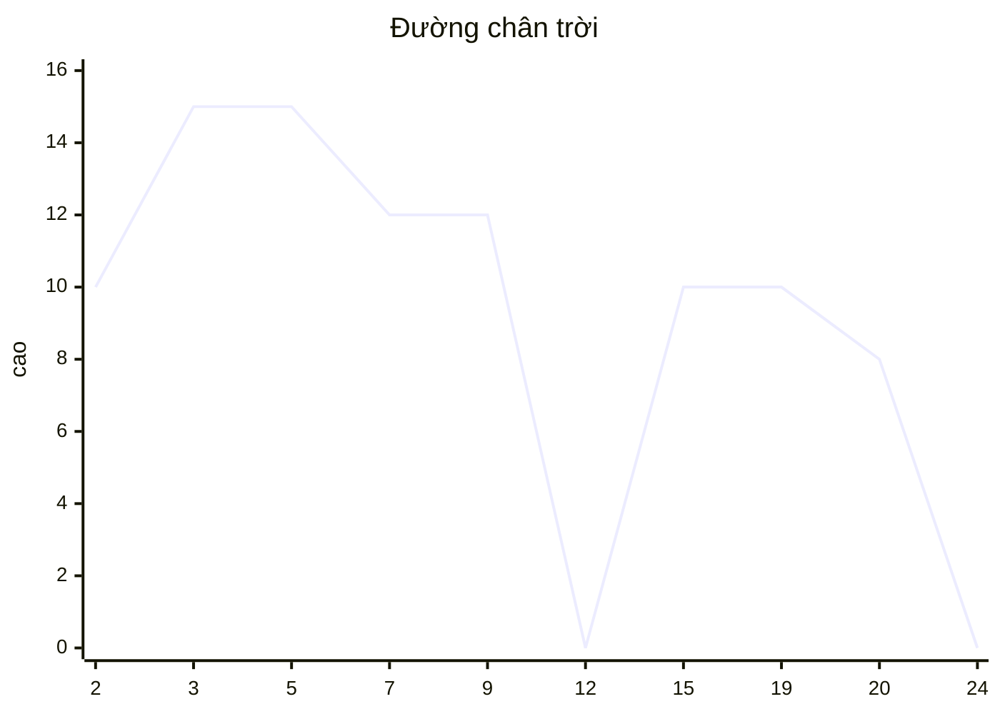

<!-- approaches: Sweep line with a max-heap and lazy deletion · Sweep line with a TreeMap multiset -->
# 218. The Skyline Problem

**Hard** · Array · Divide and Conquer · Binary Indexed Tree · Segment Tree · [LeetCode ↗](https://leetcode.com/problems/the-skyline-problem/) · Code: [TheSkylineProblem.java](TheSkylineProblem.java) · Tests: [TheSkylineProblemTest.java](TheSkylineProblemTest.java)

## Đề bài

Các toà nhà `[trái, phải, cao]`. Trả về **đường chân trời**: các điểm `[x, h]` nơi độ cao đường viền thay đổi, sắp theo `x`, không có hai điểm liên tiếp cùng độ cao.

```
[[2,9,10],[3,7,15],[5,12,12],[15,20,10],[19,24,8]]
-> [2,10] [3,15] [7,12] [12,0] [15,10] [20,8] [24,0]
```

## Ý tưởng

> **Đường quét** từ trái sang phải. Độ cao đường viền tại `x` = **toà cao nhất đang "phủ"** `x`. Đường viền chỉ có thể đổi ở các **mép** toà nhà → chỉ cần xét các toạ độ đó.
> Giữ các toà đang phủ trong một **max-heap** theo độ cao. Toà đã kết thúc thì bỏ đi **khi nó nổi lên đỉnh** (xoá trễ — lazy deletion), vì heap không xoá phần tử giữa nhanh được.



| x | thêm toà | bỏ toà hết hạn | cao nhất | điểm mới? |
|---|---|---|---|---|
| 2 | 10 | | 10 | [2,10] |
| 3 | 15 | | 15 | [3,15] |
| 5 | 12 | | 15 | |
| 7 | | 15 | 12 | [7,12] |
| 9 | | 10 | 12 | |
| 12 | | 12 | 0 | [12,0] |

## Cách 1 — Max-heap + xoá trễ `O(n log n)` ⭐

## Cách 2 — Sự kiện + `TreeMap` đếm độ cao

Mép trái là sự kiện `(x, −h)`, mép phải `(x, +h)`; sắp xếp sao cho cùng `x` thì **bắt đầu trước kết thúc**, toà **cao** bắt đầu trước. `TreeMap` đóng vai multiset các độ cao đang hoạt động (xoá được phần tử bất kỳ trong `O(log n)`). Phát điểm mỗi khi độ cao lớn nhất thay đổi.

## Bẫy & lưu ý

- Hai toà cùng cao **chạm mép** (`[0,2,3]`, `[2,5,3]`) không được sinh điểm thừa ở `x = 2` — test có ca này.

## Bài liên quan

850 Rectangle Area II · 253 Meeting Rooms II · 1851 Minimum Interval to Include Each Query · 699 Falling Squares.
