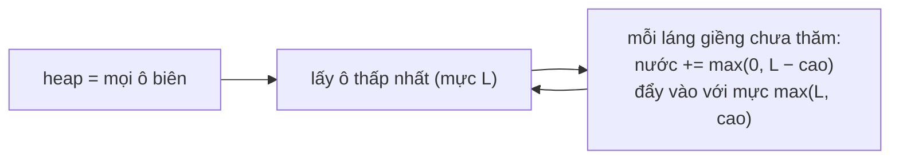

<!-- approaches: Min-heap flood from the border (Dijkstra-like) · Iterative relaxation -->
# 407. Trapping Rain Water II

**Hard** · Array · Breadth-First Search · Heap (Priority Queue) · Matrix · [LeetCode ↗](https://leetcode.com/problems/trapping-rain-water-ii/) · Code: [TrappingRainWaterII.java](TrappingRainWaterII.java) · Tests: [TrappingRainWaterIITest.java](TrappingRainWaterIITest.java)

## Đề bài

Bản đồ độ cao 2D. Sau khi mưa, giữ lại được bao nhiêu nước?

```
3 3 3 3 3
3 2 2 2 3
3 2 1 2 3        -> 10   (8 ô quanh tâm giữ 1, ô tâm giữ 2)
3 2 2 2 3
3 3 3 3 3
```

## Ý tưởng

> Ở bản 1D (bài 42), mực nước tại một cột = `min(max trái, max phải)`. Ở 2D, nước có thể thoát theo **mọi hướng**, nên mực nước của một ô = **bức tường thấp nhất trên đường thoát ra biên tốt nhất**.
> Tính bằng cách "**tràn từ ngoài vào**": đưa toàn bộ **biên** vào **min-heap**. Luôn lấy ô biên **thấp nhất** ra — nó quyết định mực nước cho các ô láng giềng chưa thăm:
> - láng giềng thấp hơn → chứa `mực − cao` nước, và gia nhập biên với mực cũ;
> - láng giềng cao hơn → không chứa nước, trở thành biên mới với độ cao của nó.



**Vì sao đúng?** Ô thấp nhất trên biên là "chỗ hở" thấp nhất của bức tường bao quanh vùng chưa thăm. Nước trong ô láng giềng không thể dâng cao hơn chỗ hở đó (sẽ tràn ra), và cũng không thể thấp hơn (mọi đường khác đều đi qua tường cao hơn). Giống hệt Dijkstra với "max" thay cho "cộng" (như 778).

## Cách 1 — Min-heap tràn từ biên `O(mn log mn)` ⭐

## Cách 2 — Thả lỏng lặp lại

Gán mực nước mọi ô bên trong là ∞, rồi lặp: `mực(ô) = max(cao(ô), min mực láng giềng)` tới khi không đổi. Đúng định nghĩa nhưng chậm — dùng làm chuẩn để test.

## Bài liên quan

42 Trapping Rain Water · 778 Swim in Rising Water · 1631 Path With Minimum Effort · 417 Pacific Atlantic Water Flow.
