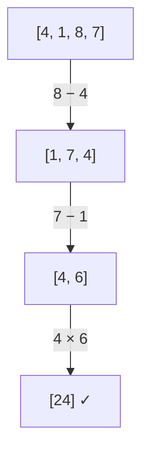

<!-- approaches: Backtracking on pairs with exact fractions · Backtracking with doubles and epsilon -->
# 679. 24 Game

**Hard** · Array · Math · Backtracking · [LeetCode ↗](https://leetcode.com/problems/24-game/) · Code: [TwentyFourGame.java](TwentyFourGame.java) · Tests: [TwentyFourGameTest.java](TwentyFourGameTest.java)

## Đề bài

Bốn lá bài số 1–9. Dùng `+ − × ÷` và ngoặc tuỳ ý để được **đúng 24**? (Phép chia là chia thực, không có dấu trừ một ngôi, không ghép chữ số.)

```
[4,1,8,7] -> true     (8 − 4) × (7 − 1) = 24
[3,3,8,8] -> true     8 ÷ (3 − 8 ÷ 3) = 24    (cần phân số!)
```

## Ý tưởng

> Phép toán **cuối cùng** của mọi biểu thức luôn kết hợp **hai** giá trị. Nên: chọn **hai số bất kỳ**, thay bằng **một kết quả** (6 khả năng: `a+b`, `a−b`, `b−a`, `a×b`, `a÷b`, `b÷a`), lặp lại với danh sách ngắn hơn. Bao quát mọi cách đặt ngoặc mà không cần sinh biểu thức.



Số trạng thái rất nhỏ: `C(4,2)·6 · C(3,2)·6 · C(2,2)·6 = 6·6·3·6·1·6 = 3888` lá — vét cạn thoải mái.

## Cách 1 — Backtracking với phân số chính xác ⭐

`8 ÷ (3 − 8 ÷ 3)`: `8 ÷ 3` không biểu diễn chính xác bằng `double`. Dùng cặp `(tử, mẫu)` rút gọn bằng GCD → so sánh tuyệt đối chính xác.

## Cách 2 — `double` + sai số

Ngắn hơn; so `|x − 24| < 10⁻⁶`. Đủ dùng cho 4 lá bài (test kiểm tra cả 495 bộ bài, và đếm đúng **404** bộ giải được).

## Bẫy & lưu ý

- Không chia cho 0.
- Duyệt **cặp có thứ tự** (`i ≠ j`) thì chỉ cần 4 phép (`a−b` và `b−a` được phủ bởi hai thứ tự); duyệt cặp không thứ tự (`i < j`) thì cần đủ 6.

## Bài liên quan

282 Expression Add Operators · 241 Different Ways to Add Parentheses · 494 Target Sum.
