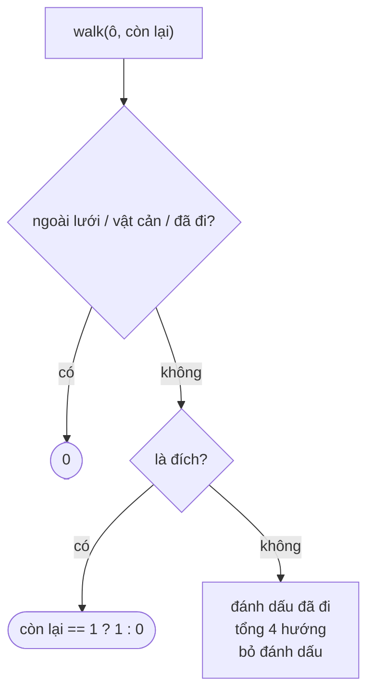

<!-- approaches: Backtracking over empty cells · Bitmask DP -->
# 980. Unique Paths III

**Hard** · Array · Backtracking · Bit Manipulation · Matrix · [LeetCode ↗](https://leetcode.com/problems/unique-paths-iii/) · Code: [UniquePathsIII.java](UniquePathsIII.java) · Tests: [UniquePathsIIITest.java](UniquePathsIIITest.java)

## Đề bài

Lưới: `1` xuất phát, `2` đích, `0` ô trống, `−1` vật cản. Đếm số đường đi (4 hướng) từ xuất phát tới đích **đi qua mọi ô không phải vật cản đúng một lần**.

```
1  0  0  0
0  0  0  0       -> 2
0  0  2 -1
```

## Ý tưởng

> Đây là bài đếm **đường Hamilton** trên lưới — không có công thức nhanh, phải **thử hết** bằng backtracking. Lưới nhỏ (≤ 20 ô) nên khả thi.
> Đếm trước số ô cần đi (`free`); mỗi bước giảm đi 1. Tới đích **đúng lúc** chỉ còn lại chính ô đích → một đường hợp lệ.



## Cách 1 — Backtracking ⭐

Đánh dấu ô đang đi bằng cách tạm đổi thành `−1`, xong thì trả lại giá trị cũ. Tối đa `3^ô` (mỗi bước có tối đa 3 hướng chưa quay lại).

## Cách 2 — DP bitmask

Trạng thái `(ô hiện tại, tập ô đã đi)`; cùng một trạng thái có thể đạt tới bằng nhiều đường → memo giúp không tính lại. `O(ô · 2^ô)` — đây là kỹ thuật của bài **người du lịch (TSP)**, dùng lại ở 847 Shortest Path Visiting All Nodes.

## Bẫy & lưu ý

- Ô xuất phát cũng tính vào `free` (đã được "đi" ngay từ đầu).
- Không được đi **qua** ô đích giữa chừng — tới đích là dừng.

## Bài liên quan

62 Unique Paths · 63 Unique Paths II · 79 Word Search · 847 Shortest Path Visiting All Nodes.
