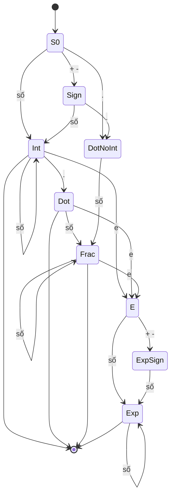

<!-- approaches: Single pass with flags · Deterministic finite automaton -->
# 65. Valid Number

**Hard** · String · [LeetCode ↗](https://leetcode.com/problems/valid-number/) · Code: [ValidNumber.java](ValidNumber.java) · Tests: [ValidNumberTest.java](ValidNumberTest.java)

## Đề bài

Kiểm tra chuỗi có phải số hợp lệ: số nguyên hoặc thập phân (dấu tuỳ chọn; chữ số với tối đa một dấu `.`; ít nhất một chữ số), có thể theo sau bởi `e`/`E` và một **số nguyên**.

```
hợp lệ:     "2"  "0089"  "-.9"  "4."  "2e10"  "+6e-1"  "-123.456e789"
không hợp lệ: "e3"  "1e"  "99e2.5"  "--6"  "."  "95a54e53"
```

## Ý tưởng

> Viết ra đúng ngữ pháp:
> `[dấu] (chữ số+ [. chữ số*] | . chữ số+) [(e|E) [dấu] chữ số+]`
> Cài đặt bằng **một lượt với ba cờ** (đã gặp chữ số / dấu chấm / số mũ) hoặc bằng **máy trạng thái hữu hạn (DFA)**.

Luật của cách một lượt:
- **dấu** `+/−`: chỉ ở đầu chuỗi hoặc ngay sau `e`;
- **`e`**: chỉ một lần, và phải có chữ số trước nó; sau `e` phải có chữ số mới → reset cờ chữ số;
- **`.`**: chỉ một lần và không được sau `e`;
- kết thúc: phải có chữ số (ở phần cuối cùng).



## Cách 1 — Một lượt với cờ `O(n)` ⭐

## Cách 2 — DFA

Bảng chuyển trạng thái 9 × 4 (chữ số, dấu, `e`, `.`). Trạng thái chấp nhận: đang trong phần nguyên, ngay sau dấu chấm có chữ số trước, trong phần thập phân, trong phần mũ. Cách này dễ mở rộng và dễ chứng minh đúng.

Test so cả hai cách với biểu thức chính quy trên 50 000 chuỗi ngẫu nhiên.

## Bài liên quan

8 String to Integer (atoi) · 468 Validate IP Address · 591 Tag Validator · 736 Parse Lisp Expression.
