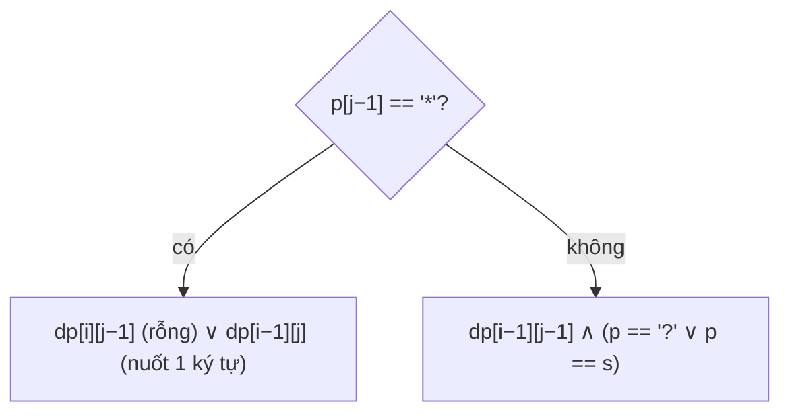

<!-- approaches: DP over (pattern, string) prefixes · Greedy with star backtracking -->
# 44. Wildcard Matching

**Hard** · String · Dynamic Programming · Greedy · Recursion · [LeetCode ↗](https://leetcode.com/problems/wildcard-matching/) · Code: [WildcardMatching.java](WildcardMatching.java) · Tests: [WildcardMatchingTest.java](WildcardMatchingTest.java)

## Đề bài

So khớp **toàn bộ** chuỗi với mẫu: `?` khớp đúng một ký tự, `*` khớp dãy bất kỳ (kể cả rỗng).

```
("adceb", "*a*b") -> true      ("acdcb", "a*c?b") -> false
```

## Ý tưởng — DP

> `dp[i][j]` = `s[0..i)` khớp `p[0..j)`.
> - `p[j−1] == '*'`: dấu sao khớp **rỗng** (`dp[i][j−1]`) **hoặc** "nuốt" thêm `s[i−1]` (`dp[i−1][j]` — dấu sao vẫn còn dùng tiếp).
> - Ngược lại: ký tự khớp (`?` hoặc bằng nhau) **và** `dp[i−1][j−1]`.



Khởi tạo: `dp[0][j]` đúng khi `p[0..j)` toàn là `*`.

## Cách 1 — DP `O(m·n)` ⭐

## Cách 2 — Tham lam với "quay lui về dấu sao gần nhất"

Nhớ vị trí `*` cuối cùng và vị trí trong `s` mà nó bắt đầu khớp. Lệch → cho dấu sao **nuốt thêm một ký tự** rồi thử lại. Chỉ cần nhớ dấu sao **gần nhất** vì dấu sao sau có thể bù cho mọi thứ dấu sao trước làm được. `O(1)` bộ nhớ.

## So với bài 10 Regular Expression Matching

Ở bài 10, `*` gắn với ký tự **đứng trước** (`a*` = không hoặc nhiều chữ `a`); ở đây `*` đứng một mình và khớp **bất kỳ** dãy nào.

## Bài liên quan

10 Regular Expression Matching · 72 Edit Distance · 1023 Camelcase Matching.
