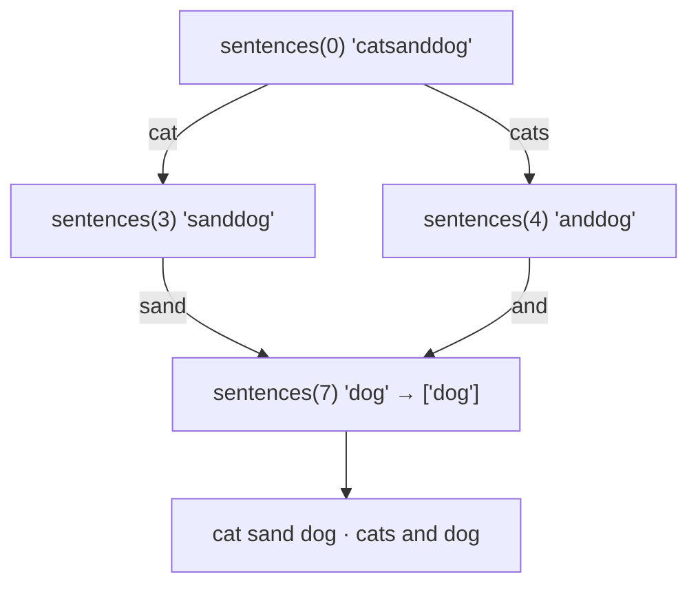

<!-- approaches: Backtracking with memo on suffixes · DP check first, then build -->
# 140. Word Break II

**Hard** · Array · Hash Table · String · Dynamic Programming · [LeetCode ↗](https://leetcode.com/problems/word-break-ii/) · Code: [WordBreakII.java](WordBreakII.java) · Tests: [WordBreakIITest.java](WordBreakIITest.java)

## Đề bài

Chèn dấu cách vào `s` để mọi từ đều có trong từ điển. Liệt kê **mọi** câu có thể.

```
"catsanddog", [cat, cats, and, sand, dog] -> ["cats and dog", "cat sand dog"]
```

## Ý tưởng

> Từ vị trí `start`, thử mọi **từ trong từ điển** bắt đầu ở đó; với mỗi từ, ghép nó với **mọi câu** của phần còn lại. Cùng một hậu tố có thể được hỏi nhiều lần → **ghi nhớ** danh sách câu theo vị trí bắt đầu.



`sentences(7)` được dùng lại cho hai nhánh — đó là lý do cần memo.

## Cách 1 — Backtracking + memo theo hậu tố ⭐

## Cách 2 — DP kiểm tra trước, rồi mới dựng câu

Bước 1 là bài 139 Word Break: `ok[i]` = hậu tố từ `i` có tách được không (rẻ, `O(n²)`). Bước 2 chỉ backtrack vào các vị trí `ok` — không bao giờ đi vào ngõ cụt. Hữu ích khi có nhiều ngõ cụt (ví dụ `"aaaa…ab"` với từ điển toàn chữ `a`).

## Độ phức tạp

Số câu có thể là **lũy thừa** theo `n` (ví dụ `"aaaa…"` với từ điển `{a, aa, aaa…}`), nên không lời giải nào tránh được trường hợp xấu — memo chỉ giúp không tính lại.

## Bài liên quan

139 Word Break · 472 Concatenated Words · 131 Palindrome Partitioning · 212 Word Search II.
