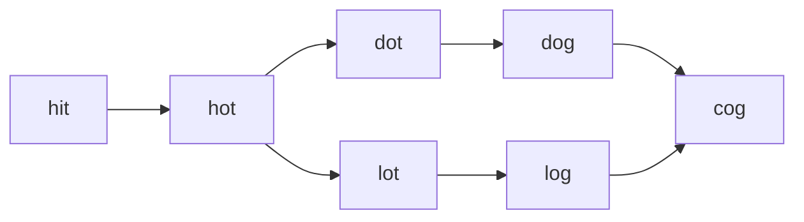

<!-- approaches: BFS with wildcard buckets · Bidirectional BFS -->
# 127. Word Ladder

**Hard** · Hash Table · String · Breadth-First Search · Bidirectional Search · [LeetCode ↗](https://leetcode.com/problems/word-ladder/) · Code: [WordLadder.java](WordLadder.java) · Tests: [WordLadderTest.java](WordLadderTest.java)

## Đề bài

Biến `beginWord` thành `endWord`, mỗi bước đổi **một chữ cái**, mọi từ trung gian phải có trong `wordList`. Trả về **số từ** trong dãy ngắn nhất (tính cả hai đầu), không có → 0.

```
hit → hot → dot → dog → cog   -> 5
```

## Ý tưởng

> Mỗi từ là một đỉnh; hai từ kề nhau nếu khác đúng một chữ. "Dãy ngắn nhất" trên đồ thị không trọng số → **BFS**.
> Tìm láng giềng hiệu quả bằng **mẫu ký tự đại diện**: `hot` thuộc các nhóm `*ot`, `h*t`, `ho*`. Mọi từ trong cùng nhóm khác nhau đúng ở vị trí `*` → là láng giềng.



| nhóm | các từ |
|---|---|
| `*ot` | hot, dot, lot |
| `do*` | dot, dog |
| `*og` | dog, log, cog |

## Cách 1 — BFS + nhóm ký tự đại diện `O(N·L²)` ⭐

Dùng xong một nhóm thì **xoá** — mọi từ trong nhóm đã được đưa vào hàng đợi (cùng mẹo với 1345 Jump Game IV).

## Cách 2 — BFS hai chiều

Mở rộng đồng thời từ `beginWord` và `endWord`, luôn mở rộng phía **nhỏ hơn**; dừng khi chạm nhau. Láng giềng tìm bằng cách thử 26 chữ cái ở mỗi vị trí. Số đỉnh thăm giảm mạnh (từ `bᵈ` xuống khoảng `2·b^(d/2)`).

## Bẫy & lưu ý

- `endWord` không có trong danh sách → 0 ngay.
- Đáp án là **số từ**, không phải số bước (lệch 1).

## Bài liên quan

126 Word Ladder II (liệt kê mọi dãy ngắn nhất) · 433 Minimum Genetic Mutation · 752 Open the Lock · 815 Bus Routes.
