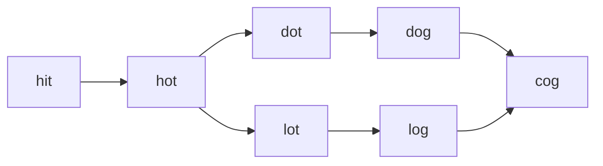

<!-- approaches: BFS by layers recording parents, then backtrack paths from the end -->
# 126. Word Ladder II

**Hard** · Hash Table · String · Backtracking · Breadth-First Search · [LeetCode ↗](https://leetcode.com/problems/word-ladder-ii/) · Code: [WordLadderII.java](WordLadderII.java) · Tests: [WordLadderIITest.java](WordLadderIITest.java)

## Đề bài

Liệt kê **mọi** dãy biến đổi **ngắn nhất** từ `beginWord` tới `endWord`: mỗi bước đổi một chữ cái, các từ trung gian phải có trong `wordList`.

```
hit → hot → dot → dog → cog
hit → hot → lot → log → cog
```

## Ý tưởng — BFS ghi cha, rồi quay lui

> **Bài 127** chỉ cần độ dài → BFS là đủ. Ở đây cần **mọi** đường ngắn nhất:
> 1. **BFS theo tầng.** Với mỗi từ ở tầng sau, ghi lại **mọi cha** ở tầng hiện tại (một từ có thể tới từ nhiều cha cùng tầng).
> 2. Chỉ xoá các từ khỏi từ điển **sau khi xử lý xong cả tầng** — xoá ngay khi thăm sẽ làm mất cha thứ hai cùng tầng.
> 3. Dừng sau tầng chạm `endWord`. **Quay lui** từ `endWord` theo các cha về `beginWord`.



`cog` có hai cha cùng tầng (`dog`, `log`) → quay lui ra hai đường.

## Lời giải ⭐

**Vì sao quay lui từ cuối về?** Đồ thị cha chỉ chứa các cạnh nằm trên **một đường ngắn nhất nào đó tới từ đó**; đi ngược từ `endWord` thì mọi nhánh đều dẫn về `beginWord` — không có nhánh chết, không tốn công thừa (đi xuôi từ `beginWord` sẽ lạc vào nhiều nhánh không tới đích).

Sinh hàng xóm bằng cách thử 26 chữ cái ở từng vị trí: `O(L · 26)` mỗi từ, nhanh hơn so từng cặp từ khi từ điển lớn. Test so với DFS vét cạn mọi đường đơn trên từ điển nhỏ.

## Bài liên quan

127 Word Ladder · 433 Minimum Genetic Mutation · 752 Open the Lock · 1129 Shortest Path with Alternating Colors.
