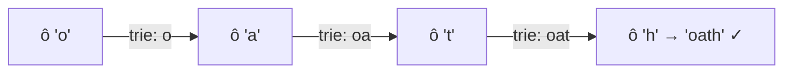

<!-- approaches: Trie + DFS with pruning · DFS per word (Word Search I repeated) -->
# 212. Word Search II

**Hard** · Array · String · Backtracking · Trie · [LeetCode ↗](https://leetcode.com/problems/word-search-ii/) · Code: [WordSearchII.java](WordSearchII.java) · Tests: [WordSearchIITest.java](WordSearchIITest.java)

## Đề bài

Lưới chữ cái và danh sách từ. Tìm mọi từ ghép được bằng một đường đi qua các ô **kề nhau** (ngang/dọc), mỗi ô dùng tối đa một lần cho mỗi từ.

```
o a a n
e t a e        words = [oath, pea, eat, rain] -> [oath, eat]
i h k r
i f l v
```

## Ý tưởng

> Chạy bài 79 Word Search cho **từng từ** thì lặp lại rất nhiều công: các từ chung tiền tố bị tìm lại từ đầu. Đưa mọi từ vào một **Trie** và DFS trên lưới **đồng thời** đi trong Trie: một lần đi qua đường `o → a → t` kiểm tra cùng lúc mọi từ bắt đầu bằng `oat…`.
> Ô tiếp theo không có trong Trie → **cắt** nhánh ngay.



**Tỉa thêm:** mỗi node Trie đếm số từ **chưa tìm thấy** trong cây con (`below`). Tìm được từ nào thì giảm bộ đếm trên đường đi; cây con nào hết từ (`below == 0`) thì không bao giờ đi vào nữa. Rất quan trọng với test kiểu lưới toàn chữ `a` và từ `aaaa…`.

## Cách 1 — Trie + DFS + tỉa nhánh ⭐

- Đánh dấu ô đang đi bằng `'#'`, xong thì trả lại.
- Gán `word = null` khi tìm được để không thêm trùng.

## Cách 2 — Word Search I cho từng từ

`O(số từ × m·n × 4ᴸ)`. Đúng, dùng làm chuẩn để test.

## Bài liên quan

79 Word Search · 208 Implement Trie · 211 Design Add and Search Words · 1032 Stream of Characters.
