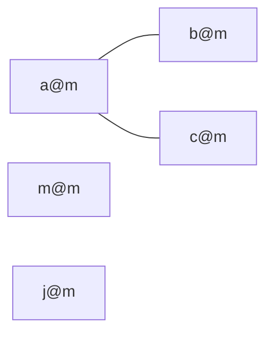

<!-- approaches: Union-find on emails · DFS on an email graph -->
# 721. Accounts Merge

**Medium** · Array · Hash Table · String · Depth-First Search · [LeetCode ↗](https://leetcode.com/problems/accounts-merge/) · Code: [AccountsMerge.java](AccountsMerge.java) · Tests: [AccountsMergeTest.java](AccountsMergeTest.java)

## Đề bài

Mỗi tài khoản là `[tên, email1, email2, …]`. Hai tài khoản **chung một email** thuộc cùng một người. Gộp lại, mỗi người trả về `[tên, các email đã sắp xếp]`.

```
John: a, b      John: a, c      Mary: m      John: j
-> John: a, b, c        Mary: m        John: j     (hai "John" sau là người khác nhau)
```

## Ý tưởng

> Coi mỗi **email là một đỉnh**; các email trong cùng tài khoản được nối với nhau. Mỗi **thành phần liên thông** là một người.
> Gộp các nhóm khi phát hiện chung phần tử → **Union-Find** là công cụ tự nhiên.



## Cách 1 — Union-Find trên email ⭐

1. Với mỗi tài khoản, hợp nhất mọi email với **email đầu tiên** của tài khoản đó.
2. Nhóm email theo gốc `find(email)`, dùng `TreeSet` để tự sắp xếp.
3. Tên lấy từ bảng `owner[email]`.

## Cách 2 — DFS trên đồ thị email

Nối email đầu với các email còn lại (hình sao — đủ để liên thông), rồi DFS tìm các thành phần.

## Bẫy & lưu ý

- **Không** gộp theo tên: hai người khác nhau có thể trùng tên.
- Union-Find với khoá là chuỗi: dùng `HashMap<String, String>` cho `parent`.

## Bài liên quan

684 Redundant Connection · 547 Number of Provinces · 990 Satisfiability of Equality Equations · 1202 Smallest String With Swaps.
