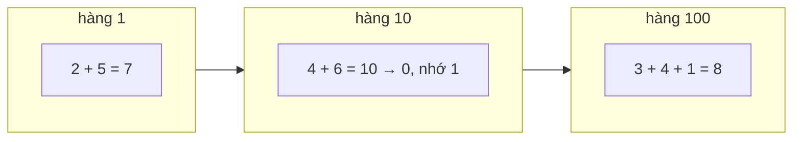

<!-- approaches: Iterative carry · Recursive -->
# 2. Add Two Numbers

**Medium** · Linked List · Math · Recursion · [LeetCode ↗](https://leetcode.com/problems/add-two-numbers/) · Code: [AddTwoNumbers.java](AddTwoNumbers.java) · Tests: [AddTwoNumbersTest.java](AddTwoNumbersTest.java)

## Đề bài

Hai số không âm lưu dưới dạng danh sách liên kết, chữ số **ngược** (hàng đơn vị đứng đầu). Trả về tổng theo cùng định dạng.

```
2 → 4 → 3      (342)
5 → 6 → 4      (465)
=> 7 → 0 → 8   (807)
```

## Ý tưởng

> Chữ số đã xếp **từ hàng đơn vị** — đúng thứ tự ta cộng tay. Chỉ việc đi song song hai danh sách, cộng từng cặp cùng **số nhớ**.



## Cách 1 — Lặp với số nhớ `O(max(m,n))` ⭐

Điều kiện vòng lặp `l1 != null || l2 != null || carry != 0` gói gọn cả ba tình huống:
danh sách dài ngắn khác nhau, và **số nhớ cuối cùng** (`99 + 1 = 100` sinh thêm một node).

| l1 | l2 | carry vào | sum | node | carry ra |
|---|---|---|---|---|---|
| 9 | 1 | 0 | 10 | 0 | 1 |
| 9 | – | 1 | 10 | 0 | 1 |
| – | – | 1 | 1 | 1 | 0 |

## Cách 2 — Đệ quy

`add(a, b, carry)` tạo node cho hàng hiện tại rồi gọi tiếp cho phần còn lại. Ngắn gọn; tốn stack `O(n)`.

## Bẫy & lưu ý

- **Không** chuyển sang `long` rồi cộng: danh sách dài tới 100 chữ số.
- Quên số nhớ cuối → `[9,9] + [1]` ra `[0,0]` thay vì `[0,0,1]`.

## Bài liên quan

445 Add Two Numbers II (chữ số thuận — dùng stack hoặc đảo list) · 67 Add Binary · 415 Add Strings · 66 Plus One.
