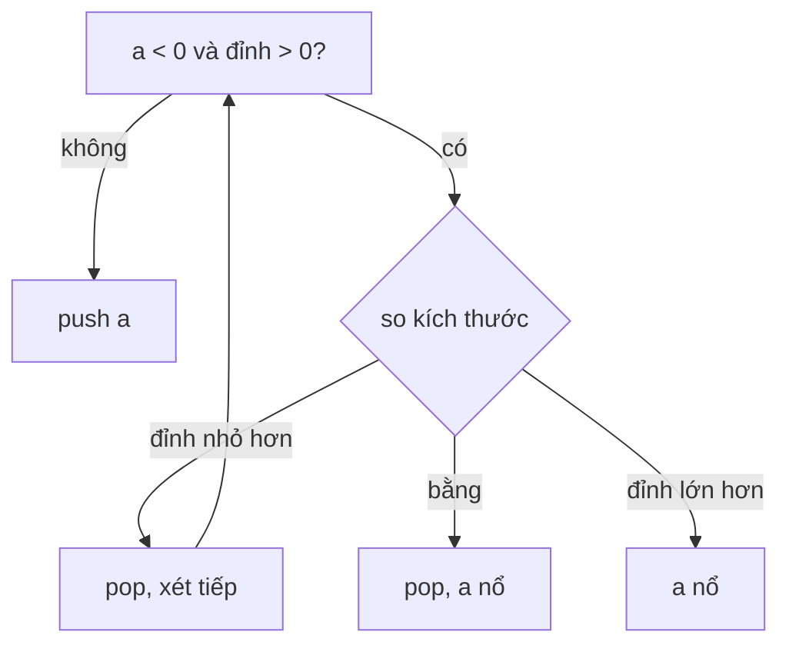

<!-- approaches: Stack of surviving asteroids -->
# 735. Asteroid Collision

**Medium** · Array · Stack · Simulation · [LeetCode ↗](https://leetcode.com/problems/asteroid-collision/) · Code: [AsteroidCollision.java](AsteroidCollision.java) · Tests: [AsteroidCollisionTest.java](AsteroidCollisionTest.java)

## Đề bài

Các thiên thạch trên một đường thẳng: dấu là hướng (`+` sang phải, `−` sang trái), trị tuyệt đối là kích thước. Gặp nhau thì cái nhỏ nổ; bằng nhau thì cả hai nổ. Trạng thái cuối cùng?

```
[10, 2, -5] -> [10]      (−5 phá 2, rồi bị 10 phá)
[-2, -1, 1, 2] -> không va chạm (đi ra xa nhau)
```

## Ý tưởng

> Chỉ có một kiểu va chạm: thiên thạch **sang phải** ở bên trái gặp thiên thạch **sang trái** ở bên phải. Stack giữ các thiên thạch còn sống; thiên thạch mới đi sang trái thì "đâm" vào đỉnh stack chừng nào đỉnh còn đi sang phải.

| a | stack | ghi chú |
|---|---|---|
| 10 | [10] | |
| 2 | [10, 2] | |
| −5 | [10] | 2 &lt; 5 → 2 nổ |
| | [10] | 10 &gt; 5 → −5 nổ |



## Lời giải — Stack `O(n)` ⭐

Mỗi thiên thạch vào và ra stack nhiều nhất một lần. Test so sánh với mô phỏng va chạm từng cặp kề nhau.

## Bài liên quan

20 Valid Parentheses · 1047 Remove All Adjacent Duplicates · 2211 Count Collisions on a Road · 853 Car Fleet.
