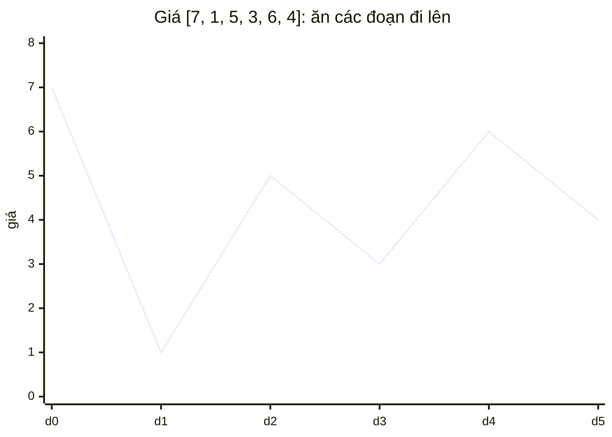
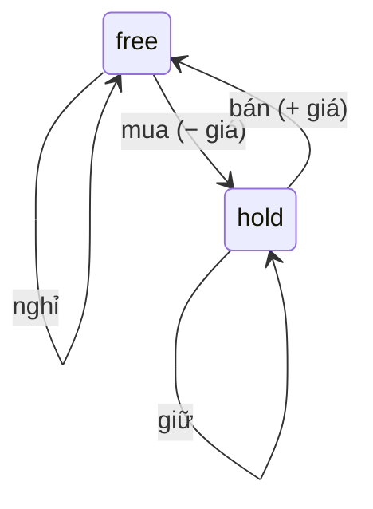

<!-- approaches: Sum of every rise (greedy) · Valley/peak · State-machine DP -->
# 122. Best Time to Buy and Sell Stock II

**Medium** · Array · Dynamic Programming · Greedy · [LeetCode ↗](https://leetcode.com/problems/best-time-to-buy-and-sell-stock-ii/) · Code: [BestTimeToBuyAndSellStockII.java](BestTimeToBuyAndSellStockII.java) · Tests: [BestTimeToBuyAndSellStockIITest.java](BestTimeToBuyAndSellStockIITest.java)

## Đề bài

Giá cổ phiếu theo ngày. Được mua/bán **bao nhiêu lần cũng được**, nhưng giữ tối đa một cổ phiếu tại một thời điểm. Lợi nhuận lớn nhất?

```
[7,1,5,3,6,4] -> 7    mua 1 bán 5 (+4), mua 3 bán 6 (+3)
[1,2,3,4,5]   -> 4    mua 1 bán 5 (= cộng mọi bước tăng 1+1+1+1)
```

## Ý tưởng

> Mỗi đoạn **tăng giá** từ ngày `i−1` sang ngày `i` đều có thể "ăn" được. Lợi nhuận tối đa = **tổng mọi bước tăng**.
> Mua ở đáy, bán ở đỉnh một lần = cộng tất cả các bước tăng nhỏ giữa đáy và đỉnh.



| ngày | giá | chênh lệch | cộng |
|---|---|---|---|
| 1 | 1 | −6 | 0 |
| 2 | 5 | +4 | 4 |
| 3 | 3 | −2 | 0 |
| 4 | 6 | +3 | 3 |
| 5 | 4 | −2 | 0 |
| | | | **7** |

## Cách 1 — Cộng mọi bước tăng (tham lam) ⭐

## Cách 2 — Đáy và đỉnh

Đi xuống tới đáy, mua; đi lên tới đỉnh, bán. Cùng kết quả, gần với cách người ta giao dịch hơn.

## Cách 3 — DP hai trạng thái

`hold` = tiền tốt nhất khi **đang giữ** cổ phiếu, `free` = khi **không giữ**.



Cách này **mở rộng được** cho mọi biến thể: phí giao dịch (714 — trừ phí khi bán), thời gian chờ (309 — thêm trạng thái "cooldown"), giới hạn k lần (123, 188).

## Bài liên quan

121 Best Time to Buy and Sell Stock (1 lần) · 309 with Cooldown · 714 with Transaction Fee · 123 III (2 lần, Hard) · 188 IV (k lần, Hard).
