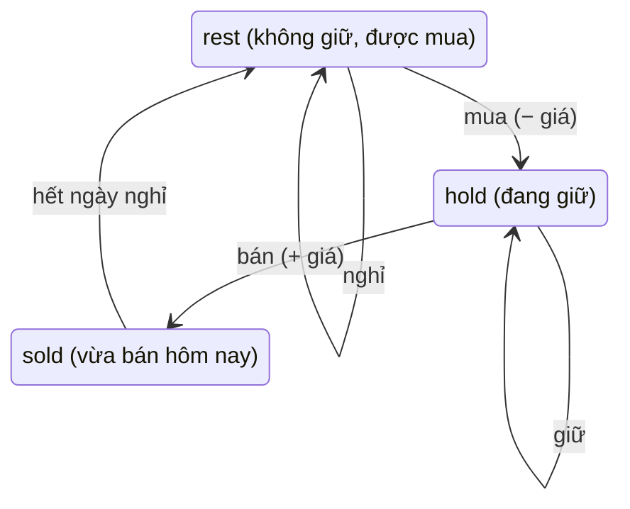

<!-- approaches: Memoized recursion · State machine DP (three states) -->
# 309. Best Time to Buy and Sell Stock with Cooldown

**Medium** · Array · Dynamic Programming · [LeetCode ↗](https://leetcode.com/problems/best-time-to-buy-and-sell-stock-with-cooldown/) · Code: [BestTimeToBuyAndSellStockWithCooldown.java](BestTimeToBuyAndSellStockWithCooldown.java) · Tests: [BestTimeToBuyAndSellStockWithCooldownTest.java](BestTimeToBuyAndSellStockWithCooldownTest.java)

## Đề bài

Mua bán bao nhiêu lần cũng được (giữ tối đa một cổ phiếu), nhưng **sau khi bán phải nghỉ một ngày** mới được mua lại.

```
[1,2,3,0,2] -> 3     mua(1) bán(2) nghỉ mua(0) bán(2)
```

## Ý tưởng

> Mở rộng máy trạng thái của bài 122 thêm trạng thái **"vừa bán"** (đang trong ngày nghỉ bắt buộc).



| ngày | giá | hold | sold | rest |
|---|---|---|---|---|
| 0 | 1 | −1 | −∞ | 0 |
| 1 | 2 | −1 | 1 | 0 |
| 2 | 3 | −1 | 2 | 1 |
| 3 | 0 | 1 | −1 | 2 |
| 4 | 2 | 1 | **3** | 2 |

Đáp án = `max(sold, rest)` (cuối cùng không nên còn giữ cổ phiếu).

## Cách 1 — Đệ quy có nhớ

Trạng thái `(ngày, đang giữ?)`. Bán xong thì nhảy tới `ngày + 2` — đó chính là ngày nghỉ.

## Cách 2 — Máy trạng thái ba biến `O(n) · O(1)` ⭐

Chỉ có thể **mua từ `rest`** — không mua được ngay từ `sold`. Đây là toàn bộ khác biệt so với bài 122.

## Bài liên quan

122 Best Time II · 714 with Transaction Fee · 123 III (Hard) · 188 IV (Hard) · 198 House Robber (cũng là "không chọn hai ngày liền nhau").
