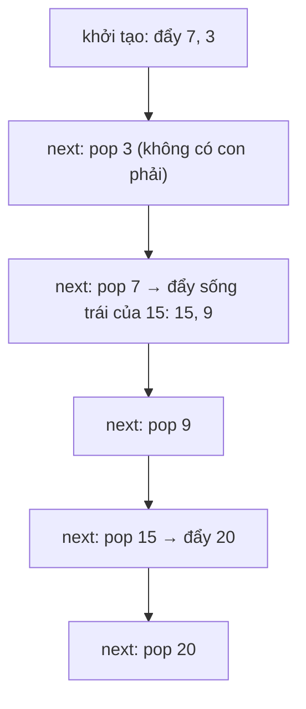

<!-- approaches: Flatten with inorder · Controlled recursion with a stack -->
# 173. Binary Search Tree Iterator

**Medium** · Stack · Tree · Design · Binary Search Tree · [LeetCode ↗](https://leetcode.com/problems/binary-search-tree-iterator/) · Code: [BinarySearchTreeIterator.java](BinarySearchTreeIterator.java) · Tests: [BinarySearchTreeIteratorTest.java](BinarySearchTreeIteratorTest.java)

## Đề bài

Thiết kế iterator duyệt BST theo thứ tự tăng dần: `next()` trả giá trị nhỏ tiếp theo, `hasNext()` cho biết còn hay không. Follow-up: trung bình `O(1)` mỗi lần gọi, bộ nhớ `O(h)`.

## Ý tưởng

> Đây là **inorder lặp (bài 94) bị "cắt nhỏ"**: thay vì chạy hết một lượt, ta dừng sau mỗi node và tiếp tục khi `next()` được gọi lại. Trạng thái dừng giữa chừng chính là **stack**.
> Stack luôn chứa "**sống trái**" chưa thăm; đỉnh stack là phần tử nhỏ nhất còn lại.

| gọi | stack sau (đỉnh bên phải) | trả về |
|---|---|---|
| khởi tạo | 7 3 | |
| next | 7 | 3 |
| next | 15 9 | 7 |
| next | 15 | 9 |
| next | 20 | 15 |
| next | | 20 |

## Cách 1 — Duyệt hết vào danh sách

`O(1)` mỗi lần gọi nhưng bộ nhớ `O(n)` — không đạt follow-up.

## Cách 2 — Stack sống trái ⭐

- Một lần `next()` có thể đẩy nhiều node (`O(h)`), nhưng **mỗi node chỉ được đẩy và lấy ra đúng một lần** trong cả quá trình → trung bình `O(1)`.
- Bộ nhớ: stack chỉ chứa tối đa một đường đi từ gốc xuống → `O(h)`.

## Bài liên quan

94 Binary Tree Inorder Traversal · 230 Kth Smallest Element in a BST · 284 Peeking Iterator · 1586 BST Iterator II.
