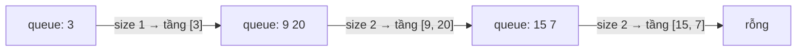

<!-- approaches: BFS by levels · DFS with depth -->
# 102. Binary Tree Level Order Traversal

**Medium** · Tree · Breadth-First Search · Binary Tree · [LeetCode ↗](https://leetcode.com/problems/binary-tree-level-order-traversal/) · Code: [BinaryTreeLevelOrderTraversal.java](BinaryTreeLevelOrderTraversal.java) · Tests: [BinaryTreeLevelOrderTraversalTest.java](BinaryTreeLevelOrderTraversalTest.java)

## Đề bài

Duyệt cây **theo từng tầng**, mỗi tầng từ trái sang phải, trả về danh sách các tầng.

```
    3
   / \
  9  20       -> [[3], [9, 20], [15, 7]]
    /  \
   15   7
```

## Ý tưởng

> **BFS** thăm node theo thứ tự xa dần gốc. Để tách các tầng: ở đầu mỗi vòng, **số phần tử trong hàng đợi đúng bằng số node của tầng hiện tại** — chốt con số đó rồi lấy ra đúng chừng ấy node.



## Cách 1 — BFS chốt kích thước tầng ⭐

**Khuôn BFS theo tầng** — học thuộc, vì nó giải ngay: 103 (zigzag), 107 (từ dưới lên), 199 (nhìn từ phải), 637 (trung bình tầng), 515 (max tầng), 111 (độ sâu nhỏ nhất), 116.

```
while queue không rỗng:
    size = queue.size()          # chốt trước khi thêm con
    lặp size lần: poll, xử lý, thêm con vào queue
```

## Cách 2 — DFS mang theo độ sâu

Preorder (trái trước phải) và thêm giá trị vào danh sách của tầng `depth`. Lần đầu tới một độ sâu mới thì tạo danh sách cho nó. Thứ tự trong mỗi tầng vẫn đúng trái → phải.

## Độ phức tạp

`O(n)` thời gian. Bộ nhớ: BFS `O(chiều rộng)` (tới `n/2` với cây đầy), DFS `O(h)`.

## Bài liên quan

103 Zigzag Level Order · 107 Level Order II · 199 Right Side View · 637 Average of Levels · 104 Maximum Depth.
