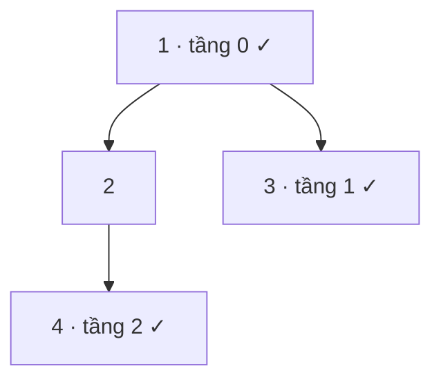

<!-- approaches: BFS taking the last of each level · DFS right-first -->
# 199. Binary Tree Right Side View

**Medium** · Tree · Depth-First Search · Breadth-First Search · Binary Tree · [LeetCode ↗](https://leetcode.com/problems/binary-tree-right-side-view/) · Code: [BinaryTreeRightSideView.java](BinaryTreeRightSideView.java) · Tests: [BinaryTreeRightSideViewTest.java](BinaryTreeRightSideViewTest.java)

## Đề bài

Đứng bên **phải** cây nhìn vào: thấy những node nào, từ trên xuống?

```
      1          <- 1
     / \
    2   3        <- 3
   /
  4              <- 4   (nhánh trái vẫn thấy được vì bên phải không có gì che)
```

## Ý tưởng

> Ở mỗi tầng chỉ thấy được **node phải nhất**. Không phải "luôn đi phải" — nếu tầng đó bên phải trống thì node bên trái sẽ lộ ra.



## Cách 1 — BFS, lấy node cuối mỗi tầng ⭐

Dùng khuôn BFS theo tầng (bài 102), ghi node có chỉ số `size − 1`.

## Cách 2 — DFS ưu tiên bên phải

Thăm **phải trước trái**. Node đầu tiên chạm tới ở mỗi độ sâu chính là node nhìn thấy (`depth == out.size()`).

## Bẫy & lưu ý

- Lỗi hay gặp: chỉ đi theo `right` từ gốc → sai với cây ví dụ trên (bỏ sót `4`).

## Bài liên quan

102 Level Order Traversal · 513 Find Bottom Left Tree Value · 545 Boundary of Binary Tree.
