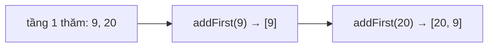

<!-- approaches: BFS + reverse odd levels · BFS with a deque · DFS by depth -->
# 103. Binary Tree Zigzag Level Order Traversal

**Medium** · Tree · Breadth-First Search · Binary Tree · [LeetCode ↗](https://leetcode.com/problems/binary-tree-zigzag-level-order-traversal/) · Code: [BinaryTreeZigzagLevelOrderTraversal.java](BinaryTreeZigzagLevelOrderTraversal.java) · Tests: [BinaryTreeZigzagLevelOrderTraversalTest.java](BinaryTreeZigzagLevelOrderTraversalTest.java)

## Đề bài

Duyệt theo tầng kiểu **zigzag**: tầng 0 trái → phải, tầng 1 phải → trái, tầng 2 trái → phải…

```
    3
   / \
  9  20        -> [[3], [20, 9], [15, 7]]
    /  \
   15   7
```

## Ý tưởng

> Thứ tự **thăm** node vẫn là BFS bình thường; chỉ thứ tự **ghi** vào kết quả đổi chiều ở tầng lẻ.
> Ghi vào một **deque**: tầng chẵn thêm vào cuối, tầng lẻ thêm vào **đầu**.



## Cách 1 — BFS rồi đảo tầng lẻ

Đơn giản nhất; đảo tốn thêm `O(k)` mỗi tầng (tổng vẫn `O(n)`).

## Cách 2 — BFS + deque ⭐

## Cách 3 — DFS theo độ sâu

Preorder, tầng chẵn `add`, tầng lẻ `addFirst` (dùng `LinkedList` để chèn đầu `O(1)`).

## Bẫy & lưu ý

- Đừng đổi thứ tự **thêm con vào hàng đợi** (phải trước trái) — làm vậy sẽ hỏng thứ tự ở các tầng sau.

## Bài liên quan

102 Level Order Traversal · 107 Level Order II · 199 Right Side View.
