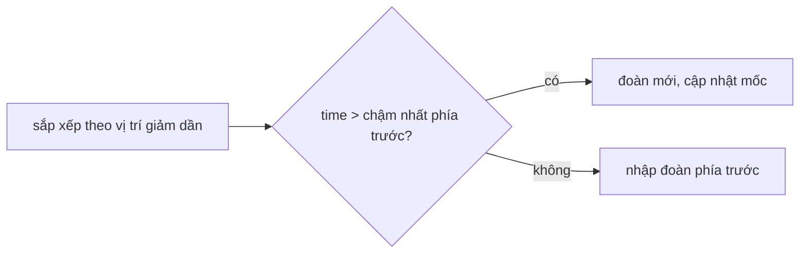

<!-- approaches: Sort by position + stack of arrival times · Sort + single running max -->
# 853. Car Fleet

**Medium** · Array · Stack · Sorting · Monotonic Stack · [LeetCode ↗](https://leetcode.com/problems/car-fleet/) · Code: [CarFleet.java](CarFleet.java) · Tests: [CarFleetTest.java](CarFleetTest.java)

## Đề bài

`n` xe chạy trên đường một làn tới `target`. Xe đuổi kịp xe chậm hơn phía trước thì phải chạy theo (thành một **đoàn**). Có bao nhiêu đoàn về đích?

```
target = 12, position = [10,8,0,5,3], speed = [2,4,1,1,3] -> 3
```

## Ý tưởng

> Tính **thời gian tới đích** của mỗi xe nếu chạy một mình: `(target − pos) / speed`. Xét xe **từ gần đích nhất trở về sau**:
> - Xe tới đích **muộn hơn** đoàn phía trước → không đuổi kịp → **đoàn mới**.
> - Tới **sớm hơn hoặc bằng** → đuổi kịp trước (hoặc đúng lúc) về đích → nhập vào đoàn trước, bị kéo chậm lại.

| vị trí | thời gian một mình | đoàn |
|---|---|---|
| 10 | 1 | đoàn 1 (mốc 1) |
| 8 | 1 | ≤ 1 → nhập đoàn 1 |
| 5 | 7 | > 1 → đoàn 2 (mốc 7) |
| 3 | 3 | ≤ 7 → nhập đoàn 2 |
| 0 | 12 | > 7 → đoàn 3 |



## Cách 1 — Stack thời gian các đoàn

Kiểu stack đơn điệu — dễ liên hệ với 739, 84.

## Cách 2 — Một biến "chậm nhất phía trước" ⭐

Chỉ phần tử **đỉnh** stack được dùng, nên một biến là đủ.

## Bẫy & lưu ý

- Thời gian là số thực → dùng `double` (hoặc so sánh phân số bằng nhân chéo như trong test để tránh sai số).

## Bài liên quan

739 Daily Temperatures · 1776 Car Fleet II (Hard) · 84 Largest Rectangle in Histogram.
