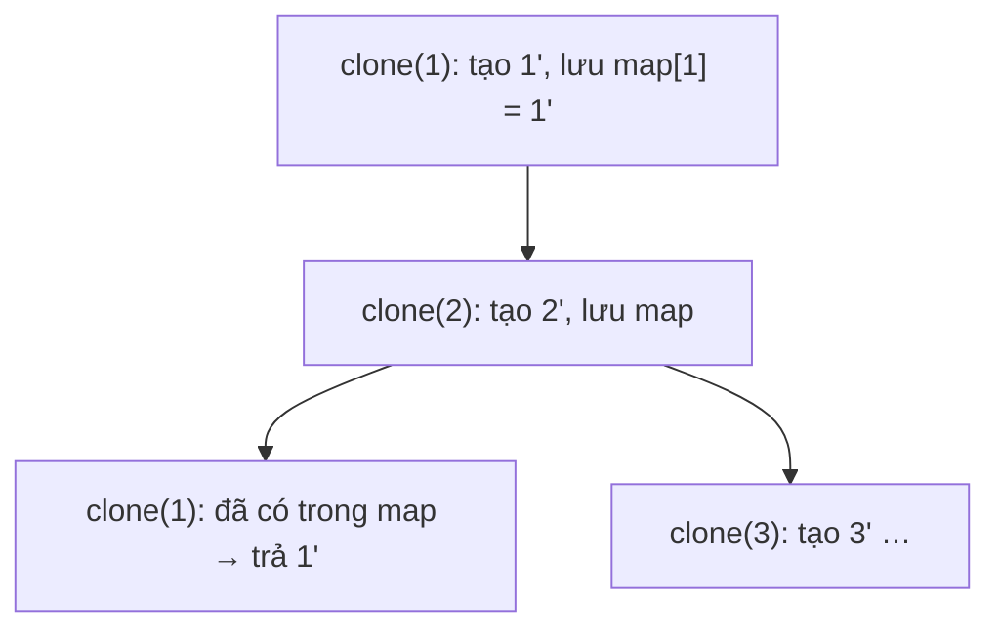

<!-- approaches: DFS with a map · BFS with a map -->
# 133. Clone Graph

**Medium** · Hash Table · Depth-First Search · Breadth-First Search · Graph Theory · [LeetCode ↗](https://leetcode.com/problems/clone-graph/) · Code: [CloneGraph.java](CloneGraph.java) · Tests: [CloneGraphTest.java](CloneGraphTest.java)

## Đề bài

Tạo **bản sao sâu** (deep copy) của một đồ thị vô hướng liên thông, cho trước một node.

```
1 — 2
|   |       -> một đồ thị mới cùng cấu trúc, không dùng chung node nào với bản gốc
4 — 3
```

## Ý tưởng

> Duyệt đồ thị (DFS/BFS) và tạo bản sao cho mỗi node. Bài toán thật sự nằm ở **chu trình**: `1 → 2 → 1 → …` sẽ lặp vô hạn, và một node có thể bị sao chép nhiều lần.
> Một `HashMap<gốc, bản sao>` giải quyết cả hai: vừa là "đã thăm", vừa là nơi tra ra bản sao đã có.



## Cách 1 — DFS + map ⭐

**Lưu vào map trước khi** đệ quy sang hàng xóm — nếu không, hàng xóm trỏ ngược về sẽ tạo bản sao thứ hai.

## Cách 2 — BFS + map

Tạo bản sao khi **phát hiện** node lần đầu (lúc đưa vào hàng đợi); nối cạnh khi xử lý node.

## Bẫy & lưu ý

- Bản sao không được dùng chung **bất kỳ** node nào với bản gốc — test kiểm tra bằng `IdentityHashMap`.
- Đồ thị rỗng (`null`) → trả `null`.

## Bài liên quan

138 Copy List with Random Pointer (cùng mẹo map gốc → bản sao) · 1490 Clone N-ary Tree · 200 Number of Islands.
