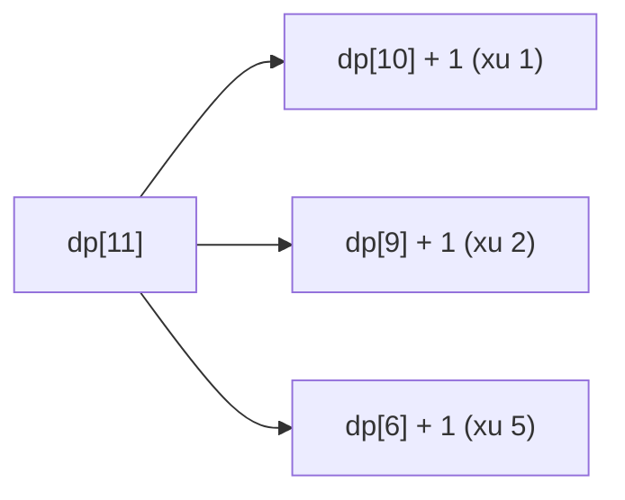

<!-- approaches: Unbounded knapsack DP (min coins) · BFS over amounts -->
# 322. Coin Change

**Medium** · Array · Dynamic Programming · Breadth-First Search · Knapsack Problem · [LeetCode ↗](https://leetcode.com/problems/coin-change/) · Code: [CoinChange.java](CoinChange.java) · Tests: [CoinChangeTest.java](CoinChangeTest.java)

## Đề bài

Có các mệnh giá xu (mỗi loại **không giới hạn**). Dùng **ít xu nhất** để được đúng `amount`; không được thì `−1`.

```
[1,2,5], 11 -> 3   (5 + 5 + 1)
```

## Ý tưởng

> **Tham lam là sai:** `[1,3,4]`, 6 → tham lam lấy `4+1+1` (3 xu), tối ưu là `3+3` (2 xu).
> **DP:** `dp[a]` = số xu ít nhất cho số tiền `a`. Đồng xu **cuối cùng** là một mệnh giá `c` nào đó → `dp[a] = 1 + min(dp[a − c])`.

`coins = [1,2,5]`:

| a | 0 | 1 | 2 | 3 | 4 | 5 | 6 | 7 | 8 | 9 | 10 | 11 |
|---|---|---|---|---|---|---|---|---|---|---|---|---|
| dp | 0 | 1 | 1 | 2 | 2 | 1 | 2 | 2 | 3 | 3 | 2 | **3** |



## Cách 1 — DP `O(amount · coins)` ⭐

Khởi tạo bằng `amount + 1` thay cho vô cực (không lời giải nào cần nhiều xu hơn `amount`), tránh tràn số khi `+1`.

## Cách 2 — BFS

Mỗi tầng BFS = thêm một xu. Lần đầu chạm `amount` chính là số xu ít nhất — đồ thị không trọng số, BFS cho đường ngắn nhất.

## Bài liên quan

518 Coin Change II (đếm số cách) · 279 Perfect Squares · 983 Minimum Cost For Tickets · 1449 Form Largest Integer With Digits That Add up to Target.
