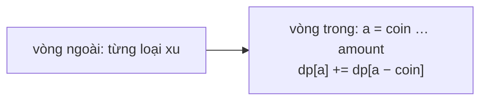

<!-- approaches: Memoized recursion · 2D DP · 1D DP (coins outer loop) -->
# 518. Coin Change II

**Medium** · Array · Dynamic Programming · Knapsack Problem · Complete Knapsack · [LeetCode ↗](https://leetcode.com/problems/coin-change-ii/) · Code: [CoinChangeII.java](CoinChangeII.java) · Tests: [CoinChangeIITest.java](CoinChangeIITest.java)

## Đề bài

Có bao nhiêu **tổ hợp** đồng xu (mỗi loại dùng không giới hạn) có tổng bằng `amount`? Thứ tự không quan trọng.

```
amount = 5, coins = [1,2,5] -> 4:   5 · 2+2+1 · 2+1+1+1 · 1+1+1+1+1
```

## Ý tưởng

> Xét **từng loại xu một**. `dp[a]` = số cách tạo `a` bằng các loại xu đã xét. Thêm loại xu `c`: mỗi cách tạo `a − c` (đã có thể dùng `c`) nối thêm một đồng `c` → `dp[a] += dp[a − c]`.

| a | 0 | 1 | 2 | 3 | 4 | 5 |
|---|---|---|---|---|---|---|
| chỉ xu 1 | 1 | 1 | 1 | 1 | 1 | 1 |
| + xu 2 | 1 | 1 | 2 | 2 | 3 | 3 |
| + xu 5 | 1 | 1 | 2 | 2 | 3 | **4** |



## Cách 1 — Đệ quy có nhớ

Tại xu `i`: **dùng thêm** một đồng xu `i` (vẫn ở `i`) hoặc **chuyển** sang xu `i + 1`.

## Cách 2 — Bảng 2D `dp[i][a]`

## Cách 3 — Mảng 1D `O(amount)` ⭐

**Thứ tự vòng lặp là điểm mấu chốt:**

| vòng ngoài | đếm | ví dụ amount = 3, xu {1, 2} |
|---|---|---|
| **xu** (bài này) | tổ hợp | {1,1,1}, {1,2} → 2 |
| **amount** (bài 377) | hoán vị | 1+1+1, 1+2, 2+1 → 3 |

Xu ở vòng ngoài nghĩa là các đồng xu luôn được thêm theo **thứ tự loại** → mỗi tổ hợp chỉ được dựng một lần.

## Bài liên quan

322 Coin Change (số xu ít nhất) · 377 Combination Sum IV (hoán vị) · 39 Combination Sum · 416 Partition Equal Subset Sum.
